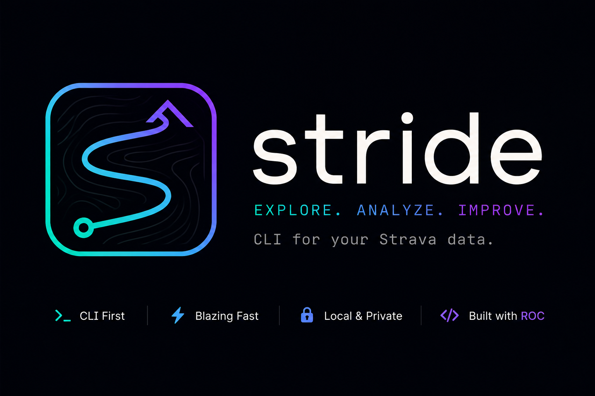
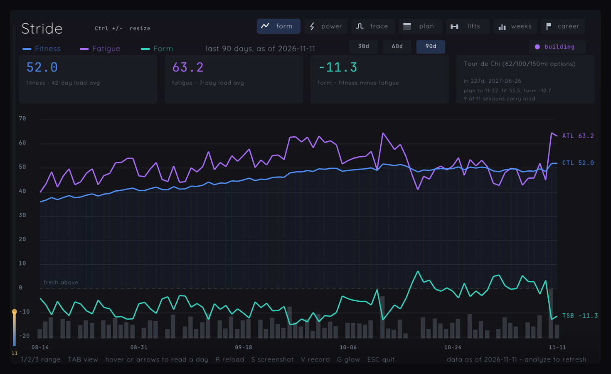
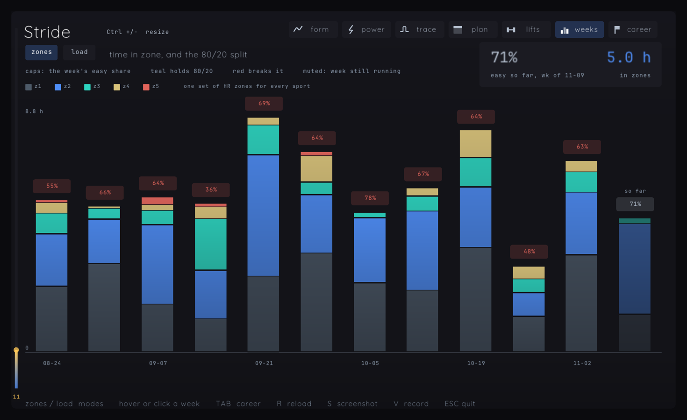
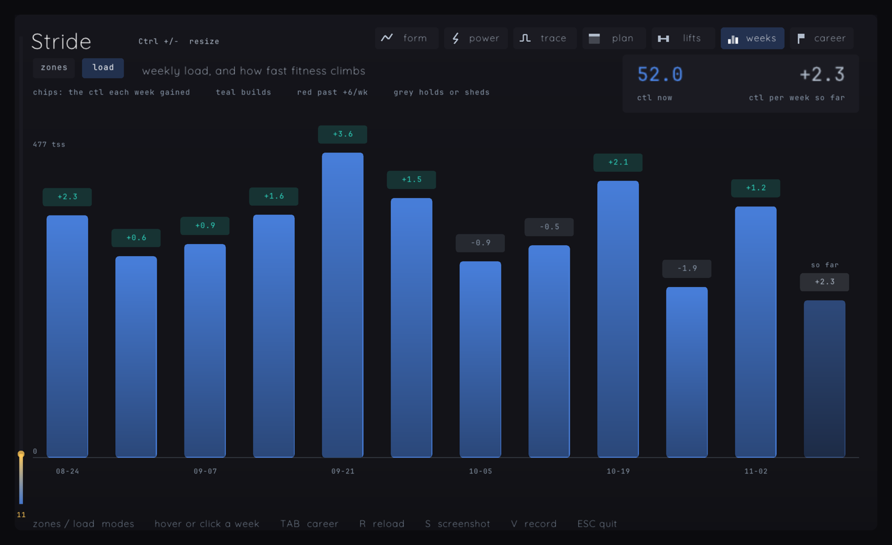
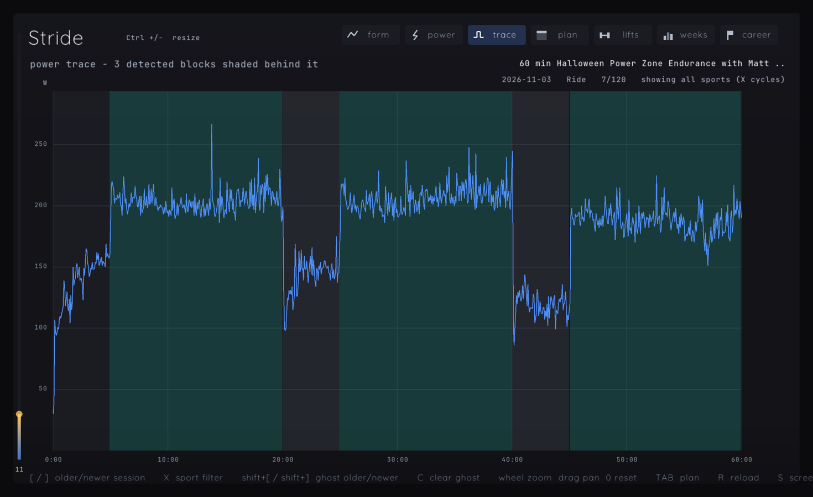
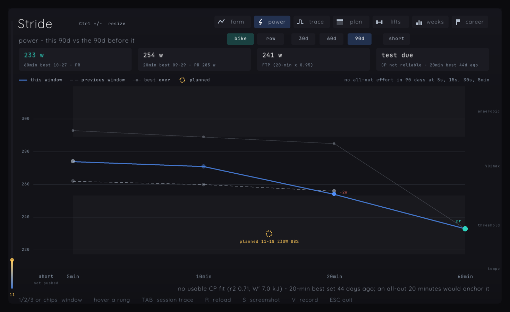
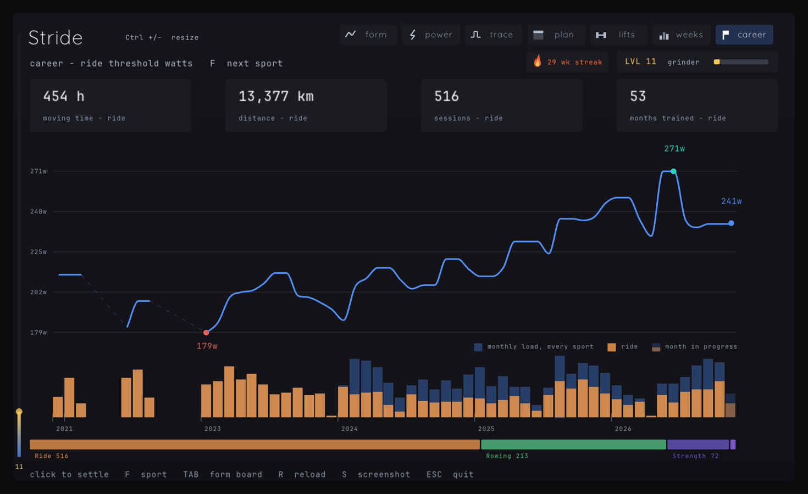

<p align="center">
  
</p>

# stride

[](https://github.com/eschizoid/stride/actions/workflows/build.yml)
[](https://github.com/eschizoid/stride/releases)
[](https://github.com/eschizoid/stride/actions/workflows/build.yml)
[](https://www.roc-lang.org)
[](#coaching-with-claude)
[](#coaching-with-claude)
[](LICENSE)

stride is a training engine for your own Strava history, for every sport: riding, running, swimming, rowing, walking and strength. It pulls your activities into a SQLite file on your machine and computes the numbers a coach needs: training load, fitness and fatigue, time in zone, polarization, derived thresholds, power and pace curves, and how each planned session went against its target. Every number is deterministic and traceable to its inputs. An AI coach such as Claude reads those numbers as JSON, adds the judgment, and writes your plan back. It never does the math.

## Install

```bash
curl -fsSL https://raw.githubusercontent.com/eschizoid/stride/main/install.sh | sh
stride setup
```

The installer picks the build for your OS and CPU (macOS arm64 and x86_64, Linux x86_64 and arm64), checks it against the release's `SHA256SUMS.txt`, and puts `stride` in `~/.local/bin`. If that directory is not on your `PATH` (a fresh macOS install leaves it off), the installer says so and prints the full path to run instead, for example `~/.local/bin/stride setup`. On macOS it also offers to install the desktop window into `~/Applications`. `STRIDE_VERSION` pins a release and `STRIDE_INSTALL_DIR` picks another directory. On Windows, download `stride-cli-windows-x86_64` and `stride-app-windows-x86_64.zip` from the [latest release](https://github.com/eschizoid/stride/releases/latest).

`stride setup` walks the first run and resumes wherever it stopped:

1. It creates the database in `~/.stride`.
2. It tells you exactly what to enter when you create your own [Strava API app](https://www.strava.com/settings/api) (callback domain `localhost`), then asks for its client ID and secret.
3. It opens Strava's authorize page and receives the code on a local port when you click Authorize. If that fails, paste the address the browser landed on.
4. It detects your timezone and asks you to confirm it, so "today" is your local day.
5. It asks for one heart rate, your threshold HR or else your max HR, and derives your four zone bounds from it.
6. It runs the first sync and analyze, then shows `stride doctor`.

Holding Strava API credentials needs an active Strava subscription ([Strava's announcement](https://communityhub.strava.com/insider-journal-9/an-update-to-our-developer-program-13428)). Without one, `stride import <export.zip>` loads the account export Strava emails you (Settings → My Account → Download or Delete Your Account). The export is summary-level only, so nothing that needs a stream (normalized power, power and pace curves, interval detection) exists for those activities.

The first sync pulls your whole history but stays inside Strava's read limits: it stops after about 95 reads, says so, and continues when you run it again 15 minutes later. A long history takes a few days of that. After the first pull, a sync takes seconds.

## Coaching with Claude

The repo ships a coaching skill at [`skills/stride/`](skills/stride/SKILL.md). In Claude Code, run `/plugin marketplace add eschizoid/stride` and install `stride`. Codex installs the same skill with `codex plugin add`, or by asking it to install the `skills/stride` directory from this repo. Then talk to it about your training. A coaching session runs:

1. `stride sync` and `stride analyze` to bring the data up to date.
2. `stride plan` for the planning bundle: form, zones, recent sessions, open sessions and adherence.
3. `stride complete`, `stride skip` and `stride relabel` to reconcile last week's plan against what you did.
4. `stride review` for the whole week in one payload: each session against its target, planned versus actual load, intensity and every sport.
5. `stride week add` to plan the coming days, with targets on power (`3x12:00@230W`), heart rate (`1x60:00@HR125-147`), zone (`1x90:00@Z2`), pace (`5x4:00@4:10/km`, `10x100m@1:40/100m`, `6x500m@1:55/500m`) or effort rating (`1x45:00@RPE6`).
6. `stride project` and `stride events` to see where the plan takes your fitness on a date.

The coach reads stride's numbers and adds the judgment; stride never prescribes. Without an agent everything still works: the human tables carry the same numbers. A new athlete can also let the agent run setup: `stride setup --json` never prompts, answers with the next step and what it needs, and takes one `key=value` per call.

## What it computes

```terminaloutput
$ stride summary
── stride report (as of 2026-08-17) ──────────────────

  fitness (CTL): 36   fatigue (ATL): 42   form (TSB): -6
  → form -6, up 6 from a week ago — modeled fatigue building, 3 days in this band
  ramp: +0/wk · +2/wk over 28d

  last 28 days:
    21 sessions · 19.1h · 324.9 km
    training load: 1232 (75% measured by power or pace — rest estimated from HR/RPE; see doctor)
    time in HR zones: Z1 211m  Z2 243m  Z3 70m  Z4 263m  Z5 0m
    polarization: 54% easy (Z1-2) / 15% moderate (Z3) / 31% hard (Z4-5)

  FTP (60d): ~239W — derived from your best 20-min power 252W
```

- **Load from the best data each session has.** Measured power, then pace (grade-adjusted for runs, IF³ for swims), then heart rate, then your own effort rating, then Strava's relative effort. Strength, HIIT and yoga score from your rating before heart rate. Each session records which method scored it, and `doctor` shows the mix.
- **Thresholds are derived, never typed in.** FTP is a sport family's best 20 minutes × 0.95 over the 60 days up to each activity, and each pace sport gets its own threshold pace the same way. Marking a session with `stride test` (`ftp20`, `ramp`, `cp3-12`, `tt30`, `css`, `5k`, `3k`) anchors the threshold to that effort.
- **Fitness, fatigue and form** (CTL, ATL, TSB) through today, so rest days count.
- **Curves and fits.** Power and pace curves with critical power and critical speed, shown only when the fit is usable.
- **Honest gaps.** A session with no usable data shows `-`, never an invented number, and every JSON field that can be missing says so with a `_known` flag.

| Sport | Load scored by |
| --- | --- |
| Ride, VirtualRide, GravelRide, MountainBikeRide | power (normalized power against the ride FTP), else pace, else heart rate |
| Rowing | power against its own rowing FTP, else pace per 500 m |
| Run, TrailRun, VirtualRun, Walk, Hike | grade-adjusted pace against the sport's threshold pace (IF²), else heart rate |
| Swim, OpenWaterSwim | pace against the swim threshold (IF³, since drag rises with speed cubed), else heart rate |
| WeightTraining, Workout, Crossfit, HIIT, Yoga, Pilates | your effort rating (`stride rate`, hours × RPE × 10), else heart rate |
| Anything else | heart rate, else Strava's relative effort, else an honest zero |

Everything lives in `~/.stride/db.sqlite`. Query it with `sqlite3`, back it up with `cp`. It holds your Strava tokens too, so stride keeps `~/.stride` owner-only.

## The desktop app

`Stride.app` reads the same database in a window: the form board, power and pace curves, a session trace with detected intervals, one day-by-day tab (the week's plan with each session's result, a day table, and a year heat map), a lifts tab with each lift's heaviest weight over time, weekly zones and ramp, and a career view. `TAB` cycles the views. Releases ship it for macOS, Linux and Windows, the installer offers it on macOS, and `just viz-app` builds it from source. A coach can steer the window through the database and capture what it shows; [docs/viz.md](docs/viz.md) has the details.

<table>
  <tr>
    <td colspan="2"></td>
  </tr>
  <tr>
    <td></td>
    <td></td>
  </tr>
  <tr>
    <td></td>
    <td></td>
  </tr>
  <tr>
    <td colspan="2"></td>
  </tr>
</table>

## Commands

`stride --help` is the one-screen manual, and [docs/commands.md](docs/commands.md) has every command in detail. Every query command prints a table in a terminal and a versioned JSON envelope with `--json`: `{"schema_version":3,"data":{…}}` on success, `{"schema_version":3,"error":{"code":"…","message":"…"}}` with exit status 1 on failure. `stride --json` lists every command with its arguments and error codes, and `schemas/v3/` describes every payload.

| Group | Commands |
| --- | --- |
| Setup | `setup [key=value]`, `init`, `auth`, `config`, `config get <key>`, `config set <key> <value>`, `config unset <key>` |
| Data | `sync [--all]`, `import <zip\|dir>`, `analyze`, `rate <activity_id\|latest> <1-10>`, `strength import <file\|->` |
| Reading | `summary`, `stats`, `doctor`, `activities [n] [sport]`, `activity <id>`, `top <metric> [n] [sport]`, `load [days]`, `zones`, `compare [week\|month]`, `review [week\|YYYY-MM-DD]`, `season`, `strength`, `power-curve [days] [sport]`, `pace-curve [days] [sport]`, `tte <watts>`, `reps [date]`, `progress [date] [asc\|desc]`, `viz` |
| Coaching | `plan`, `week`, `week all`, `week add <date> <type> <detail> <rationale> [target]`, `complete <id> [activity_id]`, `complete latest`, `skip <id> <reason> [activity_id\|none]`, `relabel <id> <type> <detail> [rationale]`, `test <activity_id> <kind>`, `test remove <activity_id>`, `event add <date> <name>`, `event remove <id>`, `events`, `project <date> [plan]` |

## Build from source

You need `just` and the pinned Roc nightly: the tag is the `nightly-tag` default in `.github/actions/setup-roc/action.yml`, downloadable from [`roc-lang/nightlies`](https://github.com/roc-lang/nightlies). `just install` symlinks the binary into `~/.local/bin`.

```bash
git clone https://github.com/eschizoid/stride.git && cd stride
just install
```

`just test` runs the pure expects, a fresh build and the offline end-to-end suite. CI runs more checks; [AGENTS.md](AGENTS.md) lists them and is the maintained guide for contributors. The decisions behind the design are in [`docs/adr/`](docs/adr/), starting with [ADR 0000](docs/adr/0000-architecture.md), which also lists what stride will never do. Open work lives in [GitHub issues](https://github.com/eschizoid/stride/issues).
