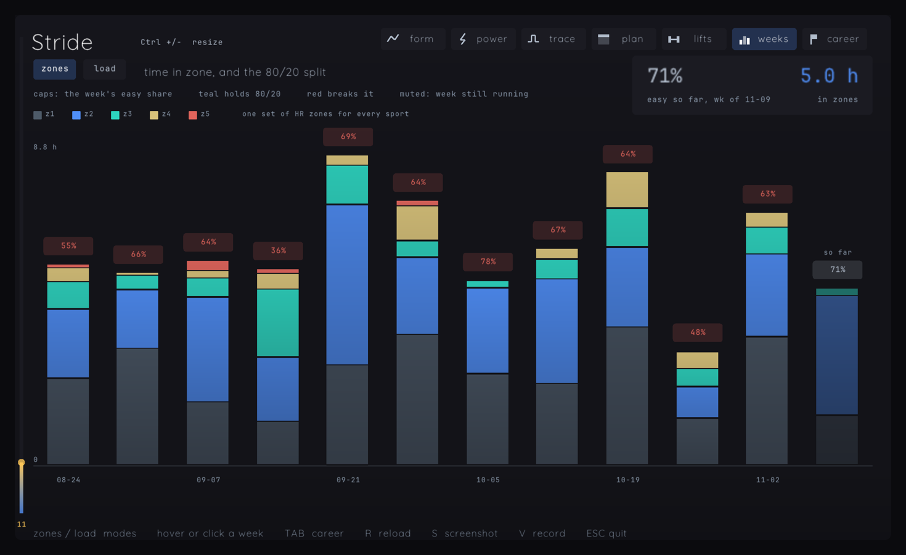
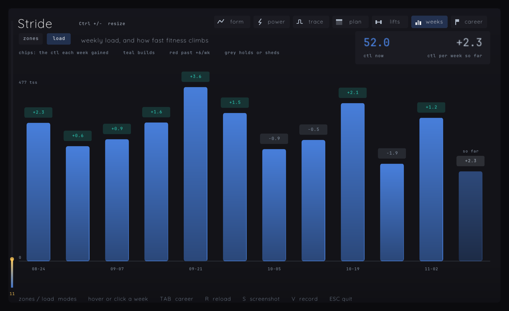
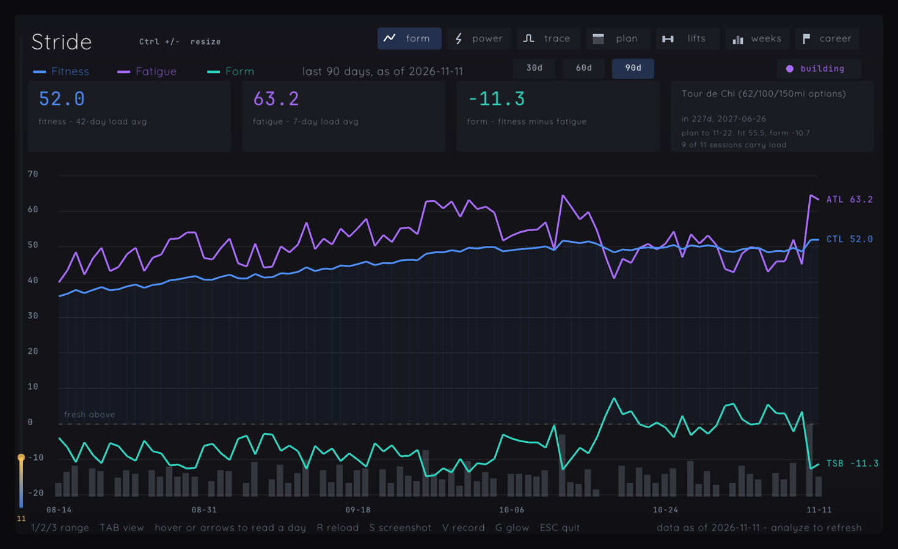
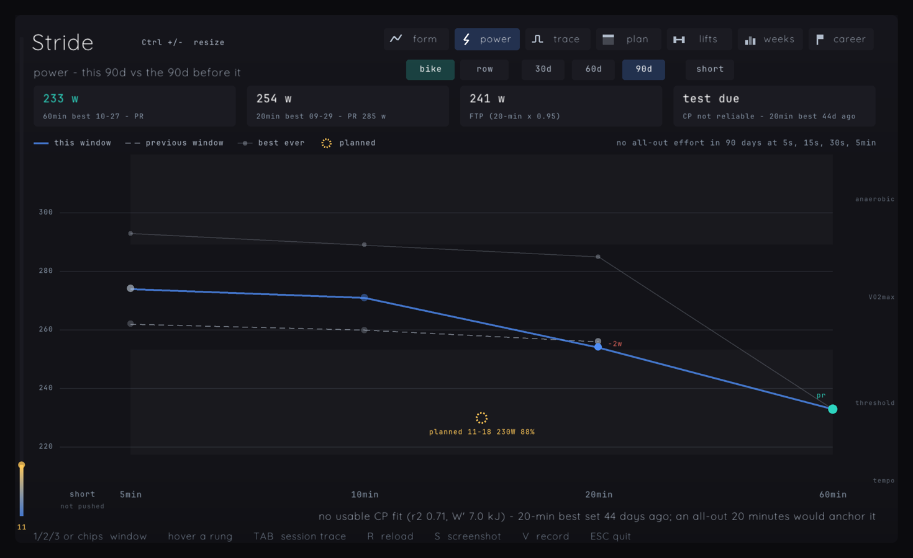
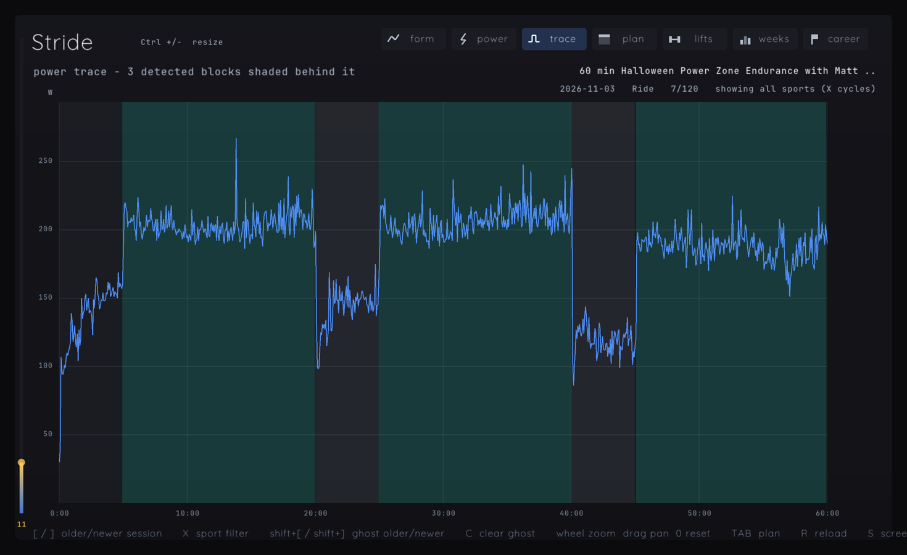

# The app window — `src/viz/`

A native window over the engine's PMC series, read at launch from
`~/.stride/db.sqlite`. This is ADR 0015 made real: pixels for the human, state
for the coach, the database as the bus. The window is a *second consumer* of
the SQLite — no export step, no baked data, nothing the CLI has to prepare.

## What it shows

- **Fitness** (CTL, blue, filled), **fatigue** (ATL, violet), **form** (TSB,
  teal — the brand accent) over the selected range.
- Daily load (TSS) as a rug along the bottom, on its own scale.
- Y-axis labels, current values at the line ends, and the next planned event:
  a dashed in-plot marker when its date is inside the plotted window, or the
  event tile's countdown (in the KPI row) when it is beyond it. A future event
  usually takes the tile form — the series ends on the last analyzed day, so
  there is rarely a column to mark.

Distance and pace surfaces (the career distance card, the km-family pace
spine, the table's day-detail line) render in the athlete's `units` config —
mi and /mi under imperial — read once at launch through the same shared rule
the CLI uses (`core.Units`); storage stays SI. Rowing and swim paces keep
/500m and /100m in every unit culture.

## The athlete HUD

Every view carries a thin XP rail on the panel's left edge. Career hours set
an athlete level (reaching level L takes 5·L·(L+1) hours, so each level costs
ten hours more than the last), the rail fills with progress through the
current level, and the level number sits at its foot. Hovering the rail opens
the sheet: level and tier, hours to the next level, and the current training
streak in consecutive Mon–Sun weeks with any load. The detail lives where it
belongs — the career view wears the level chip, XP bar and streak flame; the
plan view turns the week into a quest row of seven pips (one per weekday,
Monday first, colored by what became of that day, gold when done, pulsing
when every session is done); the power view
rings a ride record set in the last seven days in gold; the career view
turns the spine's peak gold with a breathing "all-time high" halo when the
peak is the current month, which celebrates a threshold record for EVERY
family the athlete trains, not only ride power; and the form board wears
the form verdict as a status chip (cooked / building / steady / primed /
coasting, from the same TSB the teal line ends on).

## What the form board shows

Big-number tiles carry the artifact's reading aids: fitness, fatigue and form
with their one-line meanings, plus an event slot that counts down to the next
event, says "ridden" for up to a week after one, and names the add command
when none is planned. A long event name wraps to two lines rather than
losing its end. Under the countdown the slot carries the projection: the
fitness and form `stride project` returns for the last day the written plan
reaches (open sessions after the series' last day), capped at the event, and
how many of those sessions carry a load: every target kind is priced (power,
pace, heart rate, session rating), and a session with no target or none its
inputs can price adds nothing, so that count is how much of the projection is
blind;
past the plan's last day a projection is only decay, so the board names the
day it stops ("plan to 11-08") and says "at event" only when the plan reaches
it. The subtitle always carries the as-of day, and the TSB zero rule is
captioned "fresh above" just over the rule: at its right end, else its left,
else the first spot along it clear of every load bar, preferring one no line
crosses; when bars cover the whole rule the caption rises to just above the
tallest bar.

## The day tab: week, log and year

One nav pill, `plan`, holds three day-by-day modes, picked by chips at the
left of the header: `week` (the plan view below, the default), `log` (the
data table, with as many rows as the window height holds) and `year` (the
heat view). Each mode keeps its own view id on the bus - 4 for week, 3 for
log, 5 for year - so a directive for any of them lands on this tab in that
mode, and a capture is named for its mode (`plan.png`, `data-table.png`,
`heat.png`). Clicking the pill from another view opens `week`; clicking it
from inside the tab keeps the mode on screen.

## The plan view

The week mode answers "what do I do today" and "how did the week go"
without asking anyone. A card holds today's prescription and its rationale,
or, once the day has an outcome, that outcome. The ladder below lists the
whole Monday-to-Sunday week and the six days after today, each row with its
type chip, its prescription and its status: `done` (with the day of the
linked activity when it differs), `skipped`, `rested` (a rest day past its
date with under 1.0 load, the rule `stride week` applies), `open`, or `>>`
for today. Under the prescription a second line says what happened: the
linked activity's name, minutes and load, and for a session with a
structured target its result on the target's own signal: for a power
target, the detected power work reps with their share of the target watts;
for a heart-rate, zone, pace or RPE target, the result `stride complete`
stated for it (stored on the session by `complete` and refreshed by
`stride rate`); or the skip reason and the substitute the athlete did
instead. The quest strip carries the week's done count and one pip per
weekday colored by that day's status, with a substitute day distinct from a
plain skip; the bottom strip states this week's load beside last week's,
and the coach corner shows the newest bus directive. Steerable like
everything else: a directive with view 4 opens it. "Today" here, and the
week it lists, is the athlete's civil day resolved the way the CLI resolves
it (config `timezone`, then `utc_offset_minutes`, then UTC), not the machine
clock, so the window and `stride week` name the same Monday wherever the
machine is set.

## The heat view

The year mode is a year of training at a glance: a contributions-style
calendar, one cell per day, Monday-started weeks as columns, cell intensity
scaled to the biggest TSS day in the shown window. As many weeks as the
window width holds, newest at the right edge, month ticks along the top.
Event days already ridden wear a white ring (the grid is history; the
plan view carries the coming one). Hovering a cell reads the
day back - date, TSS, and the session note when there is one. A directive
with view 5 opens it.

## The weeks tab: zones and load

One nav pill, `weeks`, holds the two twelve-week charts, picked by chips at
the left of the header: `zones` (time in zone, the default) and `load`
(weekly load and the fitness it gained). Both chart the same Monday weeks
on the same x-axis. Each mode keeps its own view id on the bus, 6 for zones
and 7 for load, so a directive for either lands on this tab in that mode,
and a capture is named for its mode (`zones.png`, `ramp.png`). Clicking the
pill from another view opens `zones`; clicking it from inside the tab keeps
the mode on screen.

One week is in focus across both modes: the bar under the pointer, else the
one last clicked (clicking it again drops it). The header line under the
chips reads that week the same way in either mode: hours in zones, easy
share, load and the fitness it gained. With no week in focus, the line shows
the mode's key.

### Zones mode

Twelve Monday weeks of time in zone as stacked bars, each capped with that
week's easy share - teal when it holds the 80/20 line, alarm red when it
does not. The current week, until the series covers all seven of its days,
is judged by neither: its bar and cap are muted, the cap says "so far", and
the card reads "easy so far". One chart, one scale: the share reads across
the row of caps, so no second panel is needed to plot it. The card names the
latest week that carried training. The intensity classification comes from
the `activity_intensity` view, which carries the same per-activity split
`stride summary` computes, so the window and the CLI share one definition
of easy and hard. A bar holds every session's zone time, while its cap counts
only the sessions polarization counts: a lifting session adds to the bar and
not to the cap. A directive with view 6 opens it.



### Load mode

The overtraining early warning, also one chart: weekly TSS as gradient
bars, each wearing a chip with the CTL that week gained. The ramp is
encoded as the chip's COLOR on the bars' own axis - teal builds, red past
+6/wk, grey sheds - rather than as a second y-axis, because two scales
sharing a plot is a lie no legend repairs. The card carries where fitness
stands and how fast it is moving; a week with no load keeps a base stub, so
the current partial week never vanishes from the row. That week, until the
series covers all seven of its days, is judged by neither: its bar and chip
are muted, the chip says "so far", and the card reads "ctl per week so far",
since a partial week's load is not a low one. The weeks come from
the `weekly_ramp` view - the one definition of weekly ramp. A directive with view
7 opens it.



## The strength view

Strength's own tab, the `lifts` pill (view 9, captured as `lifts.png`). Its headline is per lift: one row per exercise
trained on at least two days with a weight logged, most-trained first, each
with a sparkline of the heaviest weight it moved per day, the first and
latest weights (whole pounds, or kilograms to one decimal: config `units` when set, else the unit most stored weights were entered in), and an up, flat or down mark (a move
of more than 2% either way). Beside the lifts: the latest strength session's
sets (when the newest session has none, the newest one that does, with a muted line naming the newer unlogged ones); twelve Monday-started
weeks of strength sessions as bars split into sessions with sets logged and
without, the current week muted; and monthly tonnage as a small chart under
the caption "volume, not strength". Tonnage rises and falls with how many
sessions had their sets logged, so a month counts as measured only when at
least half its sessions have sets: measured months join with a solid line, a
thin month is a hollow point joined dashed, and the month in progress is a
hollow point joined dashed and muted. One fixed caption row names the last
complete month and the month in progress, each with its `covered/total`
coverage. The strength family is Sports' own, so Workout and WeightTraining
read as one, and the career view leaves the tonnage spine to this tab.

## Controls

| key / gesture | effect |
|---|---|
| `Ctrl` + `+` / `-` | increase / decrease UI size in 25% steps, from 100% to 200%; the scale fits the window so navigation remains visible |
| `Ctrl` + `0` | reset UI size to the 150% default; reloads preserve the chosen size until the app closes |
| `1` / `2` / `3` | range 30 / 60 / 90 days (form board) |
| `←` / `→` | walk the day cursor (form board; ← older, → newer, past newest turns it off) |
| `R` | reload everything from the database without reopening |
| `G` | toggle the glow pass - the scene renders offscreen and its bright parts come back blurred and added on top; if the GPU refuses any of it, the app draws exactly as before the pass existed |
| `V` | toggle a WebM recording of the screen into `captures/` under the window's working directory, named for the view it started on; FixedStep timing, so the same data replays to the same file |
| nav pills (top right) | click any view directly; the active one is filled - each wears its vector mark, drawn from primitives (no sprite sheet, crisp at any DPI) |
| `TAB` | cycle the nav left to right: form board / power view / session trace / the day tab / lifts / the weeks tab / career; from any day mode it steps on to lifts, and from either weeks mode to career |
| `week` / `log` / `year` chips (day tab) | switch the day tab between the plan, the data table and the heatmap |
| `zones` / `load` chips (weeks tab) | switch the weeks tab between time in zone and weekly load |
| click a week (weeks tab) | keep that week in focus in both modes; click it again to drop it |
| `1` / `2` / `3` or the chips (power view) | re-window the blue ladder and CP fit to 30/60/90 days |
| `shift+[` / `shift+]` (trace view) | summon / walk the ghost overlay through sessions of the live one's KIND - same sport, same unit; the walk skips the live session itself, and stepping past the last compatible one dismisses it |
| `C` (trace view) | clear the ghost in one press, from any state |
| `X` (trace view) | cycle the picker's sport filter (all / each sport the menu holds); the header names the active filter |
| wheel / drag / `0` (trace view) | zoom anchored at the cursor's moment, pan while held, reset - the window is [pan, pan+1/zoom] of the session |
| `[` / `]` (trace view) | older / newer session among those the active sport filter admits - every one is cached at load, so a switch is a memory read, not a query |
| `←` / `→` (table view) | scroll the window through the whole series (rows fill the window height) |
| click a date (table view) | open that day's detail panel: sessions, minutes, km, TSS, NP |
| window edges | drag to resize; every view reflows live (980x600 floor) |
| `S` | save a PNG of the current view into `captures/` under the window's working directory |
| mouse hover | crosshair + per-day dots + a top-right readout (form board) |
| `ESC` | quit |

The trace picks each session's channel by what its stream carries: power
when watts exist; PACE for a run, walk or swim carrying distance and time
(per-second speed differenced by the same `core.Series` discipline the
engine scores with — pauses emit nothing — then bucket-meaned to the plot,
so the line draws the pace held rather than GPS jitter); heart rate
otherwise. A pace axis labels its gridlines as pace in the athlete's units
while the samples stay SI, and faster sits higher — "up is better" holds on
every channel. The detector's blocks shade behind whichever channel draws,
and the ghost's same-kind rule compares channels, so a pace session ghosts
only against pace. A pace session also carries its SPLITS panel on the
right — the same `core.Series` rows the CLI's activity screen prints,
segmented at the athlete's split length (km or mile) with each row's pace
in their units; long runs cap at what fits and say how many rows they
hold back.

## Running it

```
just viz          # opens the window
just viz-check    # type-check only, no window
just viz-test     # the window's pure expects, the label gate among them
just viz-app      # installs ~/Applications/Stride.app
```

## Installing the released app

Releases attach `stride-app-macos-arm64.zip`,
`stride-app-macos-x86_64.zip` and `stride-app-linux-x86_64.tar.gz` — on
macOS the whole `.app`, brand fonts inside
it, built from the tagged commit and verified for architecture, signature
and fonts before it is packaged. A zip missing from a release means its
build job failed; `just viz-app` builds the same bundle locally. Unzip
anywhere and launch.

A downloaded copy carries macOS's quarantine flag, and only its binary is ad-hoc
signed — no Developer ID, no notarization — so Gatekeeper refuses the
first launch. Clear the flag once, pointing at wherever you put it:

```
xattr -dr com.apple.quarantine "/Applications/Stride.app"
```

A bundle built locally was never downloaded, so it carries no such flag.

The linux tarball has no bundle format to carry: it holds `stride-viz`, the
fonts and a `stride-app` launcher that widens PATH and seeds the fonts the
same way.

```
tar xzf stride-app-linux-x86_64.tar.gz
./stride-app/stride-app
```

It is built on the current ubuntu runner, so it needs that runner's glibc or
newer. roc-ray ships an x64glibc host only, so there is no linux-arm64 app,
and Windows has no app yet for a reason that is not packaging - see #442.

On first launch the bundle copies its fonts to `~/.stride/fonts`. Failed
copies are logged to `~/.stride/fonts-seed.log`; if the directory itself
cannot be created, the window falls back to its default font.

Both binaries build on **one compiler** — the tag is the `setup-roc` action's
default, and `tools/pin-check.sh` holds the justfile's local viz default to it,
refuses any per-job override, and refuses a compiler named in the app header.
roc-ray names no compiler, so a viz build carries no mismatch warning and
`tools/roc-viz.sh` forgives none: it runs roc, passes the exit code through,
and holds a test run to its two assertion counts.

## Typography

Quicksand (the wordmark's rounded face) carries prose — titles, legends,
captions, hints. JetBrains Mono (the tagline's voice) carries data surfaces —
KPI digits, axis ticks, readouts and the table, mixed words included, so a
data line never switches face mid-string. Both ship in `assets/fonts/` (OFL) and
the app bundle copies them to `~/.stride/fonts`; when neither location
answers, the platform default font appears instead of a crash.

## Labels: one placer, and a gate

Every string the window draws goes through one label placer,
`src/viz/Labels.roc`. A label is its measured size, the spots it may take
in order of preference, a priority and the region it must stay inside (the
plot, a chip, a card, the panel). Obstacles are what the view draws before
any text: chips, tiles, cards, bars, dots and rings as boxes, the plotted
lines as segments. The placer takes labels in priority order and gives each
the first spot inside its region that clears every obstacle box and every
label placed before it, preferring a spot no plotted line crosses. A label
with no clear spot is dropped, unless it is kept, in which case it takes its
first spot and the gate below decides whether that was clear.

`src/viz/Scene.roc` is the layer a view writes its strings through. Fixed
text (titles, chips, tile and card text, axis labels, legends, table cells,
footers) keeps one spot and never drops. Essential text with somewhere else
to go keeps, trying its spots in order: the power view's threshold value;
the career view's milestone values, the all-time-high cheer, test kinds and
withheld dot values; the form board's line-end values, its event warning
and the zero rule's "fresh above" caption; the session trace's unit label
and zoom note; and the zones mode's note on which sports have their own
heart-rate zones. Text that another surface also shows may drop: the power
view's deltas, `pr` and `new record` marks, unpushed caption and zone names
(the rung's hover card carries its values, record and push), its
planned-ring labels (the ring's card), the career view's year names and
strip names (the strip's tooltip), the form board's event marker name (the
event tile), the trace footer's shared keys (every other view's footer
carries them), and the top value of the weeks tab's scale (the focus line
reads any week). The view's own placement rules are the candidate lists: a
delta tries between its dots on the right, then the left, then above and
below; a strip name tries under its segment, then beside the strip's end;
the zero rule's caption tries the rule's right end, its left end, steps
inward from the right, the column past the rule's end, and last the same
row lifted to just above the tallest load bar.

Hover cards and tooltips (the power view's rung and ring cards, the form
board's day card, the year's day line, the XP rail's sheet) draw over
everything through the same layer, as fixed text inside their card.

The chrome every view shares (the wordmark, the scale chip, the nav pills,
the recording badge, the form board's legend and the XP rail's level) is
defined once in `src/viz/Chrome.roc`. `main.roc` draws it from those
definitions, and each view registers it as fixed text and its pills and the
XP rail as obstacles, so a view label can neither land on it nor drift from
where it is drawn. On the career view the level and streak chips share the
header row with the subtitle and the kind chips and yield to them; the
rail's hover sheet carries the level and the streak either way. The day tab's
and the weeks tab's mode chips draw their shapes under the view, and each
mode writes their labels as fixed text in its own scene.

Text width comes from a measure passed in. The window measures with the
fonts it draws with; the gate measures with headless fonts that carry the
shipped faces' advances as the window's 24 px atlas truncates them, so the
gate needs no font file and measures what the window measures.

**The gate** (`src/viz/Gate.roc`, run by `just viz-test` and so by CI's
viz job) lays every view out headless over fixture athletes at the minimum
window, the default window at 100%, and a wide display (the default window
at the default scale is the minimum layout). The athletes come from the
families in `core.Sports`: one per family, each pace family again in
imperial units, and a mixed athlete with a single session of a strength-like
sport no family holds. The fixtures per view:

- power: every curve each athlete has, at 30, 60 and 90 days, with the short
  rungs folded and shown;
- career: every spine;
- form board: every range, with an event ahead (a two-line name and a
  projection) and with the event-day story (the event marked on the plot, a
  ridden event and an unreadable event record), over a steady series whose
  zero rule runs into the load rug and a building one, and the boards with a
  load error and with no data;
- session trace: every session in the athlete's picker, in its own channel
  (power, pace in the family's unit with its splits, heart rate with a
  lifting session's sets), at home and zoomed and panned with a ghost, and
  the plot loading, empty and with no session;
- week: a planned week of sessions done, skipped with and without a
  substitute and two a day, a rest day, today's session open with a long
  prescription, and the days ahead, at the top and scrolled with the quest
  complete;
- log: the full series with session names long enough to wrap, at the top,
  scrolled with a day's detail open, and with a day loading;
- year: more weeks than the widest window holds, with and without event days,
  and with no history;
- zones and load: twelve weeks with the biggest first and the newest still
  running, with no week picked, on a picked week with per-sport zones, and
  with no history;
- lifts: more lifts than the widest window holds and the latest session's
  sets, in kilograms and scrolled in pounds, for every athlete who lifts,
  and the empty tab for every athlete who does not;
- the boot splash at every dot count, slow and not, and the XP rail's sheet.

For each scene the gate asserts that no two text boxes overlap, the
chrome's included, and that every box stays inside its region; on every
view but power and career it also asserts that no text covers a shape (a
bar, a chip, a tile, a card, a pill, the XP rail) other than the one it is
written inside. `roc test` reports only that the expect failed;
`Gate.failures` names each failure by fixture, size and the texts and
shapes involved, so `dbg` it inside the expect to read them.

## The coach's seat (ADR 0015's bus)

The window is steerable and observable through two tables it maintains in the
same database — no sockets, no protocol, just SQL:

```sql
-- a coach writing before the window's first launch creates the table too
-- (the window runs the same DDL; IF NOT EXISTS makes the race harmless):
CREATE TABLE IF NOT EXISTS viz_directives (
  id INTEGER PRIMARY KEY AUTOINCREMENT,
  created_at TEXT NOT NULL DEFAULT (datetime('now')),
  view INTEGER, range INTEGER, cursor_day TEXT, trace_day TEXT,
  ghost_day TEXT, trace_id INTEGER, ghost_id INTEGER,
  capture TEXT,                            -- png | webm_start | webm_stop
  consumed INTEGER NOT NULL DEFAULT 0,
  status TEXT NOT NULL DEFAULT 'pending',  -- applied | applied_partial | superseded | stale
  error TEXT, result TEXT, applied_at TEXT); -- result: the file a capture wrote

-- steer: the window polls ~1/s, applies the newest unconsumed row, and
-- consumes everything up to it. NULL fields mean "leave that alone".
INSERT INTO viz_directives (view, range, cursor_day, trace_day, ghost_day)
VALUES (0, 30, '2026-09-02', NULL, NULL);
-- a session is named exactly by its activity id, or loosely by its day:
-- trace_id / ghost_id take precedence over trace_day / ghost_day when both
-- are given, and a day picks whichever of that day's sessions sorts first
-- (the newest). Read the id back from the trace picker's rows, or from
-- `stride activities --json`; `viz_focus` reports the ids of what is shown.
INSERT INTO viz_directives (trace_id, ghost_id) VALUES (20355183143, 20342052869);
-- a capture: 'png' writes the view the directive lands on, once it has
-- settled (its arrival animation over - the career view's whole sweep,
-- half a second elsewhere - and no trace fetch in flight), to
-- captures/<view>.png under the window's working directory
-- (your home folder for the app bundle, the repo for `just viz`);
-- 'webm_start' / 'webm_stop' begin and end a WebM recording of it. The row
-- stays pending until the host answers - a PNG written, a recording
-- running, a recording finished - then `result` names the file by its
-- absolute path and the status closes; a refused start (one already
-- running), a refused stop (none running), a start the recorder rejected
-- or a failed write lands in `error` with no result. Captures run one at a
-- time: the bus is not polled while one waits, so a row written meanwhile
-- is applied once the first has closed (of several, the newest wins and
-- the older close superseded).
-- `stride viz --json` lists them under `captures`.
INSERT INTO viz_directives (view, capture) VALUES (1, 'png');
-- the power view's curve: a sport family's head ('Ride', 'Rowing', 'Run',
-- ...) switches it to that family's power curve, record book and CP fit;
-- 'pace:' and a sport type ('pace:Run', 'pace:Swim', 'pace:Rowing') to that
-- sport's pace curve and critical-speed fit. A value outside that
-- vocabulary is refused by name, and so is a valid one the athlete has no
-- data for.
INSERT INTO viz_directives (view, family) VALUES (1, 'pace:Run');
-- the power view's short rungs (under 5 minutes), which it folds into a
-- gutter when none was pushed all-out: 1 shows them, 0 folds them again; any
-- other value is refused by name
INSERT INTO viz_directives (view, short) VALUES (1, 1);
-- view 0..9 (form/power/trace/table/plan/heat/zones/ramp/career/lifts;
-- 3, 4 and 5 are the day tab's log, week and year modes; 6 and 7 are the
-- weeks tab's zones and load modes) - but read
-- the list from `stride viz --json`, which the running binary publishes,
-- rather than from this comment. A directive naming a view outside the
-- published range leaves the VIEW unchanged; its other fields still land,
-- because every directive field applies independently - NULL means leave
-- alone, and that contract does not change when one field is out of range. range 30|60|90 lands on the view the
-- directive lands on: named view if set, else the visible one — on the power
-- view it re-windows the ladder+fit, on every other view it sets the form board's
-- range.
-- cursor_day parks the crosshair, trace_day picks the session - and resets
-- the window's sport filter when the landed session sits outside it, so the
-- header never claims a filter the trace violates.
-- ghost_day overlays a second session on the trace view at reduced alpha
-- (same scale, same seconds-per-pixel), and only if it is the same KIND of
-- session as the one shown - same sport, same unit - and not the shown
-- session itself; a mismatch is refused with what differs spelled out.
-- The literal word 'none' dismisses the ghost. A database that predates
-- the column gains it on the window's first poll (ALTER TABLE,
-- failure-on-present discarded).

-- the window creates this too; a coach may pre-create it the same way:
CREATE TABLE IF NOT EXISTS viz_focus (
  id INTEGER PRIMARY KEY CHECK (id = 1),
  updated_at TEXT NOT NULL,
  view INTEGER NOT NULL, range INTEGER NOT NULL,
  cursor_day TEXT, trace_day TEXT, ghost_day TEXT,
  trace_id INTEGER, ghost_id INTEGER,
  detail_day TEXT, sport TEXT, family TEXT,
  curve_family TEXT, curve_short INTEGER);

-- observe: one row, upserted when what the human sees changes (throttled
-- ~2/s) and on a heartbeat every 30 seconds regardless. Beyond the session
-- it names the day whose detail panel is open on the table, the trace's
-- sport filter, the family the career view is on, the power view's curve
-- (curve_family) and whether its short rungs are shown (curve_short, 1
-- shown, 0 folded), each NULL when none
SELECT view, range, cursor_day, trace_day, trace_id, ghost_day, ghost_id,
       detail_day, sport, family, curve_family, curve_short, updated_at
FROM viz_focus;
```

The focus row has a liveness rule, and a reader must apply it: a row is
**live** only while `updated_at` is younger than the window's published
`focus_staleness_seconds` (90 s, three missed heartbeats). A window closed
by the OS button, or crashed, leaves its last row behind, and without the
rule that row reads as "the athlete is looking at this" forever. Quitting
with ESC deletes the row, so **no row** is the clean "nobody is looking";
if that last write fails (a locked database), the row it leaves behind is
retired by the same staleness rule, and a coach reading within the window
sees a stale-but-live row for at most 90 s.
`stride viz --json` applies the rule for you: its `focus` object carries
`present`, `live` and `age_seconds` beside the fields, so an agent never
computes the age itself.

The same payload carries `history`: the last ten directives, newest
first, each with its `status`, `error` and `applied_at`, so verifying a
directive is a read of the command, not a query on the table. It is
empty while no directive has been written. An id of -1 means the
directive did not name that session, the value could not be read as an
integer, or the row predates the id columns.

The lifecycle those rows go through — stale, superseded, pending until the
applying frame reports, applied — is one definition in the pure `core.Bus`
module, executed by the window every second and by `stride viz tick`, which
runs one poll-and-mark cycle against the database without a window (its
`--no-ack` leaves the winner pending, the state a window crashed between
apply and report leaves behind). The e2e suite drives the tick, so every
state above is tested where no window can open; the tick honours every
field it finds, since judging a field needs the window's model. Unlike
the window, which polls again a second later and lets a missed write
heal itself, the tick is one shot whose payload says `acked`: a sweep,
supersede or mark that does not land fails the command with an error
envelope rather than reporting a cycle that did not happen.

Everything the two paragraphs above hand-list — the view numbers, the
directive fields, the staleness window — is also self-published by the
window at every launch, and `stride viz --json` serves it. When this
prose and the binary disagree, the binary is the one telling the truth:
discovery for a tool goes through the command, not this file.


Run ONE window per database. Directives are consumed by whichever window
polls first and `viz_focus` carries whichever wrote last, so a second window
silently takes half the directives and half the answers.

Every directive reaches a terminal state, readable back by id:

- `applied` — every field honoured; `applied_at` says when.
- `applied_partial` — the window took what it could; `error` names each
  refused field ("cursor_day 1999-01-01 not in the series").
- `superseded` — a newer directive arrived before this one was applied;
  newest wins.
- `stale` — older than 600 seconds when read. A directive written while no
  window was open must not seize the one that eventually launches.

The winning row stays `pending` until the frame that applied it reports
back, so a window that crashes between reading and applying leaves the
directive retryable rather than silently lost — within the same 10-minute
freshness window; a crash retried tomorrow goes `stale`, by design. Rows
consumed before the lifecycle existed read `unknown`: their outcome was
never recorded. "applied" means the frame accepted and acted; async work
it started (a reload, a session fetch) may still fail and recover by the
window's own rules. Focus writes are throttled
(~2/s at most) and only fire when what the human sees actually changed.

One narrow race leaves a wrong history line behind a right final state:
a directive the window applied, whose ack is delayed by lock contention
past the next poll, is swept to `superseded` by that poll if a newer row
has arrived, although the frame did act on it. The screen ends where the
newest directive says, which is right; the older row's status says it
never landed, which is not. Telling the two apart needs a sequence number
the window would carry from read to ack, and this app does not need one:
a reader who cares looks at focus, not at the losing row.

## Boundaries this nightly imposes

- No F64→F32 narrowing exists, so the SQL query CASTs to integer tenths and
  the app divides by 10 — the numeric boundary belongs to SQL.
- What the window may touch is declared in its own source, and a declaration
  is matched against the text of a path. The athlete's directory sits under a
  home known only at run time, so it cannot be written there: the launcher
  resolves it and passes it as the first argument (the launch directory is the
  second), and the startup config is built from argv. The window declares that
  directory read-write, its working directory read-only (the checkout for
  `just viz`; the athlete's home for the packaged launchers, which change to it
  before they exec), and two programs: `stride` for the CP fit and `sh`, which
  asks `date` for the zone offset under the configured timezone and `pwd` for
  the working directory. Captures need no declaration: the platform writes them
  beneath `captures/`, relative to the working directory, and a capture's
  status row names the file by that directory's absolute path. Nothing else:
  no environment, no network, no other program.
  Launched with no argument, the window opens and says it has no database.
- `has` is a reserved word; uppercase identifiers are types.

## The power view (TAB)

A second screen, and the one that answers "am I holding power?": the
window's power-duration ladder drawn over the same-length window before it,
eight rungs from 5s to 60min.

Four tiles under the chips carry the headline numbers before the chart is
read: the window's best at the ladder's longest rung and at the one before it
(60 and 20 minutes on a power curve, 20 and 10 on a pace curve), each with
its day and marked `PR` when it is the all-time best, else naming the record;
the threshold the engine scores the curve's sessions with (FTP, or the
threshold pace), captioned `from test` when a marked test is in force and
`(20-min x 0.95)` otherwise, the derivation it comes from; and the window's
fit, captioned `critical power (fit)` with W' (`critical speed (fit)` with D'
on a pace curve) when it is usable, the test standing in when one is in
force, or `test due` with the 20-minute best's age. The threshold and the
fit are different models and can disagree; the captions name which is which.

The dashed threshold line carries its value at the line's left end, inside
the plot, above the line or below it when a first-rung point sits just
above.

The plot draws this window as the solid blue line, the previous window
dashed grey and the all-time record envelope as a thin faint line with small
dots, and a legend on the row above the plot names each line on the chart.
The value axis spans what is drawn on screen (all three lines, the planned
targets and the threshold line; folded short rungs do not count) with a
small margin (5% on a power curve, out to round watts; 3% under and 2% over
on a pace curve), so the gaps between the lines get the height. Behind the lines, faint bands mark the athlete's power zones from the
FTP (Coggan's seven, the same table `stride zones` prints), alternate ones
shaded and each named at the window's right edge where it is tall enough.
A pace curve draws no bands, since Stride has no pace zones.

The signed change at each rung is printed in watts beside it: teal going up,
alarm going down, nothing when either window lacks the rung. A rung whose
window best IS the record collapses to one teal dot marked "pr", with its
delta beside it, and a record set in the last seven days rings gold.
Hovering a rung opens a card beside it: the duration, this window's,
the previous window's and the all-time best with their days, the session
that set this window's best, and `not all-out` or `stale` when they apply.
The card stays inside the plot and beside the point. The CP fit reports from
the bottom-right status corner, its dashed line on the chart, only when the
fit is usable: r2 at least 0.9 and W' between 5 and 40 kJ. A fit through
steady class bests rather than maximal ones returns a W' of a few kJ, so
otherwise the line is not drawn and the footer says why, how many days ago
the window's 20-minute best was set, and that an all-out 20 minutes would
anchor the fit.

Every open session ahead with a structured target is a dashed gold ring at
its rep duration and target watts (between rungs, placed linearly in
seconds), labelled `planned`, its day and the target's share of this
window's best at that duration, read off the line between the rungs around
it. The dashes and the `planned` prefix keep a prescription from reading as a
measured best. Hovering a ring opens the same card for each session in it:
its date, type, reps, duration and watts.

The tab draws one curve at a time, named by a curve key: a sport family's
head for that family's POWER curve, or `pace:<sport_type>` for that sport's
SPEED curve. Speed is keyed by the exact sport type because critical speed is
fitted per sport, a pool swim and an open-water swim sharing no speed model,
and only the sports whose effort is their pace (the run, walk, swim and
rowing families) take a pace curve: a ride's speed follows the terrain.

The chips come from the data. Left of the range chips, right-aligned, sit the
curves the athlete has on record, most-used first, as many as fit beside the
title, the one on screen always among them: in power mode every power family,
then each pace sport whose family has no power curve; in pace mode the
reverse, so every curve is one click away. Right of the range chips, a power
and a pace chip switch between the two curves of the sport on screen, shown
only when that sport has both: a ride has no pace curve, so a bike curve shows
no pace chip. Each switch reloads the curve, the previous
window, the record book and the fit: CP and W' from `stride power-curve
<days> <family>`, or critical speed and D' from `stride pace-curve <days>
<sport>`. At launch the tab opens on the athlete's most-trained family of the
last 90 days: its power curve when it has one, else its most-used pace sport.

A pace curve plots speed, so the faster effort is the higher dot, and reads
it aloud as pace in the sport's own unit: per 500m for rowing, per 100m for
swimming, per kilometre or mile (as `units` says) for the foot sports. Its
gridlines, hover card, deltas (seconds per unit, negative when the window got
faster) and the CS line speak pace. The CS line follows the CP line's rule:
drawn only from a fit with r2 at the floor and D' inside the sport's own
band (5-100 m for swimming, 10-300 m for rowing, 10-600 m on foot), and
otherwise the caption names what is wrong and the effort that would fix it.

Planned targets show where they belong, drawn as dashed gold rings labelled `planned`: a power target on the curve of
the power family the athlete trains most (a planned session names no sport, and watts do not compare across families),
a pace target on every pace curve its unit fits (`/km` and `/mi` on the run and
walk families, `/100m` on the swim family, `/500m` on the rowing family), at
the speed its pace names and the time one rep takes at that speed. A
directive's `family` field steers the same switch, and the focus row reports
the curve on screen as `curve_family`, in the same vocabulary.

A rung whose window best is within 5% of the next longer rung's best
(`flat_ratio`) was not pushed: it is that session's ordinary output, not an
all-out effort. Its dot goes muted in that window, no delta is printed
beside it (a gap between two unpushed rungs reflects which workouts were
chosen, not fitness), and the row above the plot names the window's
unpushed durations at its right, where it clears the legend. The longest rung has nothing longer to beat and is never
marked. A window best set more than half the window ago fades. Hovering a
rung names the session that set the window's best and its day, and TAB on a
hovered rung opens that session in the trace view.

A short rung (under 5 minutes) counts as pushed only when it is not flat
against the next longer rung and reaches 90% of the athlete's record at that
duration (`short_record_share`): a 1-minute best stands well above a 5-minute
one even inside an ordinary class, so flatness alone would call it all-out.
When the window holds short rungs and none was pushed, they fold into a narrow
`short / not pushed` gutter at the left and the remaining rungs take the
width; one pushed short rung shows them all. The `short` chip, right of the
range chips, shows them on demand, and appears only while there is something
to fold. The tab opens folded, and the choice holds for the rest of the
session. A directive's `short` field (1 shows, 0 folds) steers the same
switch, and the focus row reports it as `curve_short`: 1 shown, 0 folded, and
-1 (NULL in the row) when the curve on screen has nothing to fold.

The ladder itself - which columns, which family, that zero and NULL both mean unrecorded - is
the `activity_power_ladder` view's, shared with the record book and the
CLI's health report; the speed ladder is the `activity_pace_ladder` view's,
shared with `stride pace-curve`, with its rung list in `pace_ladder_rungs`.

The **points** come from the stored per-activity bests (`activity_metrics.best_*_w`),
maxed over the window. `CAST(ROUND(...))` matters — a bare `CAST` truncates and
draws the whole ladder a watt low; rounded, every rung matches
`stride power-curve 90 Ride --json`.

**CP, W′ and r2 come from the engine**, not from a second regression here. The fit
is `Metrics.hyperbolic_fit`'s job and a copy in the viz would drift from it, so the
view runs `stride power-curve --json` directly — no shell between, so the
window declares that program by name (`sh` is the one other, for the zone offset
`date` reports under the configured timezone) — and extracts each field
independently — key ORDER cannot silently break the parse, and a missing field
shows "CP fit unavailable" rather than a fit of zeros.

Rungs are spaced by INDEX rather than by duration: the ladder is a fixed 5s..60min
set, and a linear time axis piles the short rungs onto the left edge.

## Session trace view (TAB)

The third screen: one session drawn as its measured trace, with the detector's
blocks shaded behind it when the detector found any — work in the accent,
recovery and warm-up/cool-down in grey. The picker offers the last 120 sessions
carrying a stream this window can plot, whatever their sport; the plotted
channel is chosen per session by what the stream actually holds, watts where a
power meter recorded them and heart rate otherwise, and the y axis names its
unit so the two can never be confused. Both axes carry labelled gridlines, and
the x step follows the VISIBLE span, so zooming in earns finer ticks.

A lifting session (the WeightTraining family, the gate the engine's
`strength_sets` rebuild uses) has no power or pace for the detector, so its
heading names the channel only. Its stored sets fill a column at the right,
in the order the engine keeps them: exercise, sets × reps or sets × seconds
for a hold, and the weight in the athlete's units when one was moved. The
plot narrows to leave that column clear. With nothing stored, the column says
which absence it is: "no sets logged", or "no sets read" when the
description holds text no adapter parsed (what `stride strength` counts as
`pasted_unparsed`).

The ghost overlay compares the live session against another of the same
KIND — same sport, same unit — because an honest axis is not yet a meaningful
comparison: a workout and a ride both plot bpm and still answer no question
side by side. The pair is re-judged whenever the live session changes, so a
ghost cannot outlive a switch to a session of another kind.

This is the auditable view. A table of segments can tell you the
detector found seven work blocks; only the overlay tells you whether a block
started before the power did.

The trace is **downsampled in SQL** to about `trace_points` (800) samples,
every kth one, about one per pixel of plot: a long session carries several
samples per pixel, and drawing them all shows nothing more. `json_each`
reads the stored stream directly — SQLite has JSON1, and this platform has
no JSON decoder.

Both axes divide by the SAME duration, taken from the stream's last timestamp.
Deriving it from the segments instead would stretch partial detector coverage
across the full width, and the two can differ by less than a pixel, which
hides the error instead of showing it.

## Screenshots (S)

`S` writes a PNG of the current view into `captures/` under the window's working directory, named for the view.
Reference captures live in `docs/img/`.

These are how the agent reviews its own rendering. Every value drawn derives from
JSON the coach already reads losslessly, so a frame is worthless for judging
TRAINING — but it is the only way to see whether the drawing itself is right.
Code can type-check and have every data path diffed against the engine and
still overprint one label on another, render a glyph the font lacks as `?`,
format a count as `3.0`, or describe a line in a comment it never draws. The
label gate catches the overlaps; a capture is how the rest is seen.






