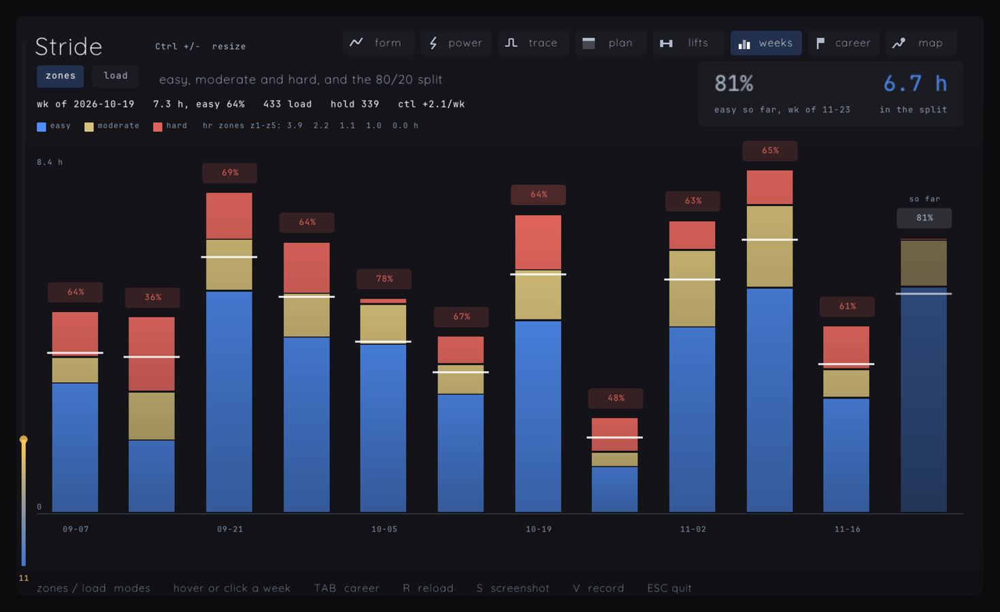
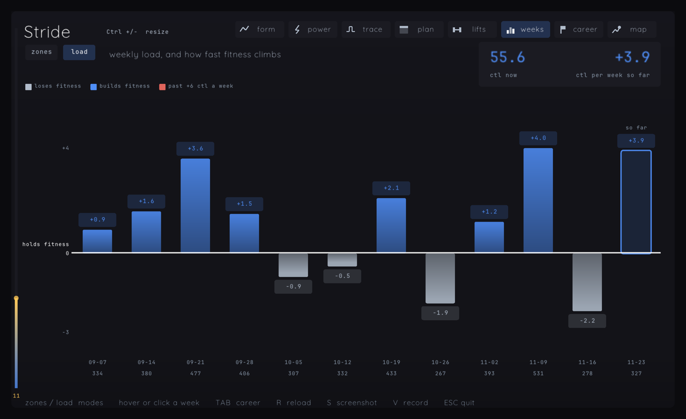
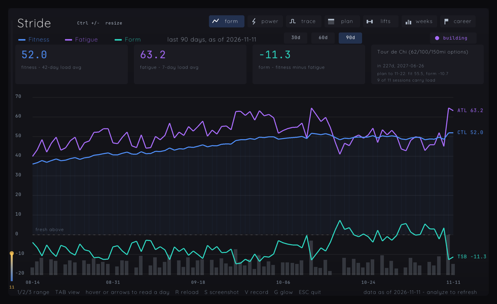
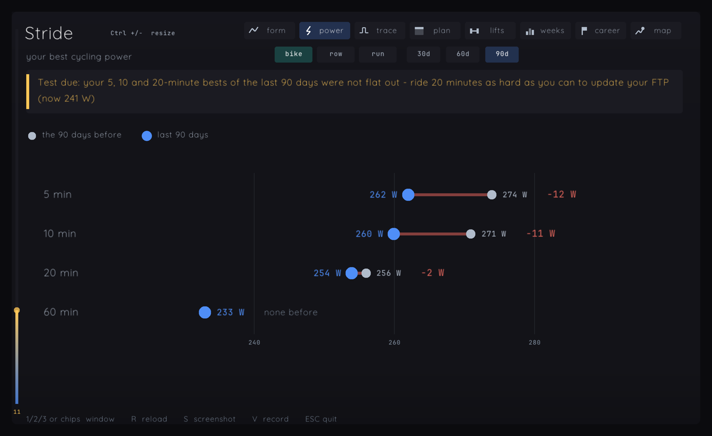
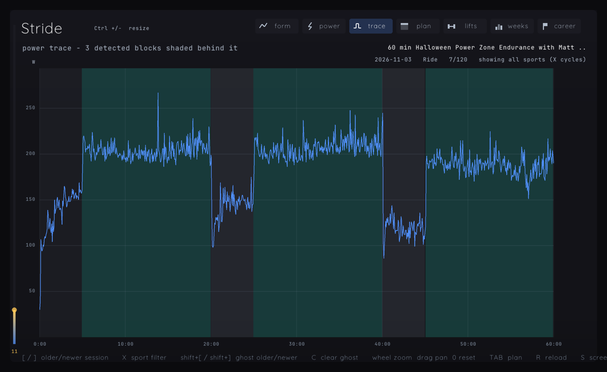

# The app window — `src/viz/`

A native window over the engine's PMC series, read at launch from
`~/.stride/db.sqlite`. This is ADR 0015 made real: pixels for the human, state
for the coach, the database as the bus. The window is a *second consumer* of
the SQLite — no export step, no baked data, nothing the CLI has to prepare.

## What it shows

- **Fitness** (CTL, blue, filled), **fatigue** (ATL, violet), **form** (TSB,
  teal — the brand accent) over the selected range.
- Daily load as a rug along the bottom, on its own scale.
- Y-axis labels, current values at the line ends, and the next planned event:
  a dashed in-plot marker when its date is inside the plotted window, or the
  event tile's countdown (in the KPI row) when it is beyond it. A future event
  usually takes the tile form — the series ends on the last analyzed day, so
  there is rarely a column to mark.

Distance and pace surfaces (the career distance card, the km-family pace
spine, the table's day-detail line) render in the athlete's `units` config —
mi and /mi under imperial — read once at launch through the same shared rule
the CLI uses (`core.Units`); storage stays SI. Rowing and swim paces keep
/500m and /100m in every unit culture.

## The athlete HUD

Every view carries a thin XP rail on the panel's left edge. Career hours set
an athlete level (reaching level L takes 5·L·(L+1) hours, so each level costs
ten hours more than the last), the rail fills with progress through the
current level, and the level number sits at its foot. Hovering the rail opens
the sheet: level and tier, hours to the next level, and the current training
streak in consecutive Mon–Sun weeks with any load. The detail lives where it
belongs — the career view wears the level chip, XP bar and streak flame; the
plan view turns the week into a quest row of seven pips (one per weekday,
Monday first, colored by what became of that day, gold when done, pulsing
when every session is done); the power view
rings a ride record set in the last seven days in gold; the career view
turns the spine's peak gold with a breathing "all-time high" halo when the
peak is the current month, which celebrates a threshold record for EVERY
family the athlete trains, not only ride power; and the form board wears
the form verdict as a status chip (cooked / building / steady / primed /
coasting, from the same TSB the teal line ends on).

## What the form board shows

Big-number tiles carry the artifact's reading aids: fitness, fatigue and form
with their one-line meanings, plus an event slot that counts down to the next
event, says "ridden" for up to a week after one, and names the add command
when none is planned. A long event name wraps to two lines rather than
losing its end. Under the countdown the slot carries the projection: the
fitness and form `stride project` returns for the last day the written plan
reaches (open sessions after the series' last day), capped at the event, and
how many of those sessions carry a load: every target kind is priced (power,
pace, heart rate, session rating), and a session with no target or none its
inputs can price adds nothing, so that count is how much of the projection is
blind;
past the plan's last day a projection is only decay, so the board names the
day it stops ("plan to 11-08") and says "at event" only when the plan reaches
it.

The plot draws the same projection. The window reads the `series` of that
one `stride project` call, the engine's walk day by day, so the board and
the command cannot disagree about a day. After the last measured day the
fitness, fatigue and form lines continue dashed to the plan's last day and
stop there, and each projected day the plan prices a load onto gets a hollow
bar on the load rug's scale; a day it priced nothing onto draws no bar. The
range chips still count measured days, and the projected days follow them.
The line-end values read the projection's last day, an event the plan
reaches is marked where it falls, and a key along the plot's top says the
dashed part is projected and how many of the window's sessions are priced,
the count the tile shows. The pointer reads projected days too: the day
card says "projected" and reads the planned load, or "unpriced" for a
session the engine could not price. The arrow cursor still counts back from
the last measured day.

The subtitle always carries the as-of day, and the TSB zero rule is
captioned "fresh above" just over the rule: at its right end, else its left,
else the first spot along it clear of every load bar, preferring one no line
crosses; when bars cover the whole rule the caption rises to just above the
tallest bar.

## The day tab: week, log and year

One nav pill, `plan`, holds three day-by-day modes, picked by chips at the
left of the header: `week` (the plan view below, the default), `log` (the
data table, with as many rows as the window height holds) and `year` (the
heat view). Each mode keeps its own view id on the bus - 4 for week, 3 for
log, 5 for year - so a directive for any of them lands on this tab in that
mode, and a capture is named for its mode (`plan.png`, `data-table.png`,
`heat.png`). Clicking the pill from another view opens `week`; clicking it
from inside the tab keeps the mode on screen.

## The plan view

The week mode answers "what do I do today" and "how did the week go"
without asking anyone. A card holds today's prescription and its rationale,
or, once the day has an outcome, that outcome. The ladder below lists the
whole Monday-to-Sunday week and the six days after today, each row with its
type chip, its prescription and its status: `done` (with the day of the
linked activity when it differs), `skipped`, `rested` (a rest day past its
date with under 1.0 load, the rule `stride week` applies), `open`, or `>>`
for today. Under the prescription a second line says what happened: the
linked activity's name, minutes and load, and for a session with a
structured target its result on the target's own signal: for a power
target, the detected power work reps with their share of the target watts;
for a heart-rate, zone, pace or RPE target, the result `stride complete`
stated for it (stored on the session by `complete` and refreshed by
`stride rate`); or the skip reason and the substitute the athlete did
instead. The quest strip carries the week's done count and one pip per
weekday colored by that day's status, with a substitute day distinct from a
plain skip; the bottom strip states this week's load beside last week's,
and the coach corner shows the newest bus directive: no line until a coach
has written one, and "directives unreadable" when the bus cannot be read.
The strip, the table's day detail and the heat card all say load, never
TSS: a session scores in TSS or session-RPE load by its model, and a
day's or a week's total blends both. Steerable like
everything else: a directive with view 4 opens it. "Today" here, and the
week it lists, is the athlete's civil day resolved the way the CLI resolves
it (config `timezone`, then `utc_offset_minutes`, then UTC), not the machine
clock, so the window and `stride week` name the same Monday wherever the
machine is set.

## The heat view

The year mode is a year of training at a glance: a contributions-style
calendar, one cell per day, Monday-started weeks as columns, cell intensity
scaled to the biggest load day in the shown window. As many weeks as the
window width holds, newest at the right edge, month ticks along the top.
Event days already ridden wear a gold ring (the grid is history; the
plan view carries the coming one). Hovering a cell reads the
day back - date, load, and the session note when there is one. A directive
with view 5 opens it.

## The weeks tab: zones and load

One nav pill, `weeks`, holds the two twelve-week charts, picked by chips at
the left of the header: `zones` (the easy, moderate and hard split, the
default) and `load` (weekly load against the load that holds fitness). Both
chart the same Monday weeks in the same slots, with the scale's labels in a
gutter at the plot's left, so no label shares a slot with a bar. Under every
bar two rows read the week the same way in both modes: its date, then its
figure (hours in zones, load in load). Each mode keeps its own view id on
the bus, 6 for zones and 7 for load, so a directive for either lands on this
tab in that mode, and a capture is named for its mode (`zones.png`,
`ramp.png`). Clicking the pill from another view opens `zones`; clicking it
from inside the tab keeps the mode on screen.

One week is in focus across both modes: the bar under the pointer, else the
one last clicked (clicking it again drops it). The header line under the
chips reads that week the same way in either mode: the hours of its split
and their easy share, its load beside its hold level, and the fitness it
gained. With no week in focus the line is empty.

The current week, until the series covers all seven of its days, is drawn
faded in both modes, with "so far" over it: over its bar in zones, over its
chip in load.

### Zones mode

Twelve Monday weeks of the polarized split as share bars: every week with
polarized time stands the plot's full height, its whole being 100% of that
week's split, stacked easy at the base, then moderate, then hard. The split
comes from the `activity_intensity` view, which classifies a session by
power or pace when it has them and by heart rate otherwise, and which
carries the same per-activity split `stride summary` computes, so the window
and the CLI share one definition of easy and hard. The bar counts only the
sessions the view marks `polarized`: a lifting session adds nothing. One
white line crosses the plot at 80%, labelled in the gutter, so the picture
gives the verdict: an easy segment that reaches the line holds 80/20, one
that falls short breaks it. The figure under each bar is the week's hours
of polarized time; a week with none keeps an empty stub and reads 0.0 h.

The card reads the latest week that carried polarized time as easy against
everything else, `81/19`, the two summing to 100, in teal when it holds
80/20 and alarm red when it breaks it; the running week reads muted, since
a partial week is not a finished one. Beside it, the hours in the split.
The key row names the three classes; with a week in focus it reads that
week's heart-rate zone hours, z1 to z5, which the bar does not draw. A
directive with view 6 opens it.



### Load mode

The overtraining early warning, also one chart on one scale: each bar is
the week's load as a share of its hold level, the load that would have left
CTL where the week started: CTL at the week's start times the days the week
counts (`core.Load.hold`), since a day whose load equals CTL is the fixed
point of the recurrence the engine builds `daily_load` with, and that
recurrence lives in the same module. So one white line at 100% serves every
week, read in the gutter where it crosses as "100 %" under its name, "holds
fitness": a bar over it gained fitness and one under it lost fitness,
except within a narrow band around the line: the recurrence weighs a late
day above an early one and the hold weighs every day alike, so a week whose
load lands on its first day can top its hold and still lose up to 1.07% of
its starting CTL, and one whose load lands on its last day can fall short
of it and still gain up to 1.12%. `core.Load` derives both bounds from the
recurrence and pins them.

Each bar wears a chip with the CTL the week gained, and bar and chip share
the verdict's color: muted for a week that held or lost fitness, blue for
one that gained, red for one that gained more than 6 CTL in the week
(`Ramp.ramp_limit`, the one constant the colors and the key read). A chip
sits above its bar, and one that would touch the line rises to sit clear
above it. The figure under each bar is the week's load. The card carries
where fitness stands and how fast it is moving, "ctl per week so far" for
the running week.

The scale fits the tallest bar, the running week's included: its top is
the largest share of any week shown, rounded up to a ten, and at least
120%, so no bar is ever cut short. The running week's hold counts only the
days it has had, so one long ride early in the week can make it the
tallest bar and lift the top. A new athlete's early weeks sit over tiny
holds and can set a tall scale, the line low on the plot and the later
weeks short beside them; the chips still read each week's CTL change. The
weeks come from the `weekly_ramp` view - the one definition of weekly
ramp; a week's start is its end-of-week CTL less its ramp, except a week
that begins on or before the first day of history, which started from
zero CTL (the engine walks `daily_load` from zero), has no hold to share
and keeps a stub. A directive with view 7 opens it.



## The strength view

Strength's own tab, the `lifts` pill (view 9, captured as `lifts.png`). Its headline is per lift: one row per exercise
trained on at least two days with a weight logged, most-trained first, each
with a sparkline of the heaviest weight it moved per day, the first and
latest weights (whole pounds, or kilograms to one decimal: config `units` when set, else the unit most stored weights were entered in), and an up, flat or down mark (a move
of more than 2% either way). Beside the lifts: the latest strength session's
sets (when the newest session has none, the newest one that does, with a muted line naming the newer unlogged ones); twelve Monday-started
weeks of strength sessions as bars split into sessions with sets logged and
without, the current week muted; and monthly tonnage as a small chart under
the caption "volume, not strength". Tonnage rises and falls with how many
sessions had their sets logged, so a month counts as measured only when at
least half its sessions have sets: measured months join with a solid line, a
thin month is a hollow point joined dashed, and the month in progress is a
hollow point joined dashed and muted. One fixed caption row names the last
complete month and the month in progress, each with its `covered/total`
coverage. The strength family is Sports' own, so Workout and WeightTraining
read as one, and the career view leaves the tonnage spine to this tab.

## The map view

The `map` pill opens the map tab, which draws every stored GPS route over a
street map, in Web Mercator with north up. Like the day tab it has modes,
switched by chips in its header, each its own view so a directive or a
capture names it: routes (view 10, captured as `map.png`), heat (11,
`map-heat.png`) and play (12, `map-play.png`). The routes are the answers
`stride sync` stores, one per outdoor session, each decoded by `core.Route`,
the rule the engine uses to tell a route from the no-GPS marker, and they
draw in the accent over the street map.

The street map is OpenStreetMap's data as OpenFreeMap serves it: vector tiles
in the OpenMapTiles schema, which the window fetches itself as the view needs
them. Water and parks (parks, nature reserves, grass and wood, but not
private gardens) are filled, opaque: water in the window's blue and parks in
a muted green of their own, each laid faintly over the map's ground. Rivers,
streets, cycleways, arterials and motorways are dim lines. Water, arterials
and motorways draw at every zoom; streets and cycleways fade in as the view
closes in on street level, where the grid stops reading as a grey wash. The
view asks for the tiles that cover it at the zoom its scale needs, each drawn
256 to 512 logical pixels across, one zoom closer than a map styled for
512-pixel tiles, for more detail. It goes up to zoom 14, where the tiles'
detail stops and a closer view draws zoom 14 larger; a view that would need
more than 48 tiles is drawn a zoom coarser, its tiles larger too. It also
asks for the one tile three zooms coarser over each, so a pan into new
ground shows coarse detail at once. A tile not yet drawn shows its nearest
drawn coarser tile, scaled up and cut to its square, so the view never shows
an empty patch where a coarser tile is held; each tile that lands repaints
the picture, and the view sharpens until every tile on screen is its own. At
most four tiles are read at once. Decoding (`Pbf`, `Mvt`, `Earcut`) and the
tile maths and cache policy (`Tiles`) are pure modules with expects. A task
waits for the cache and the network off the frame loop, but tasks run on
the frame thread, so decoding a tile holds the frames while it runs, longest
for the widest zooms.
Every fetched tile is kept raw in the `map_tiles` table, keyed by zoom,
column and row alone, with the planet build it came from, when it was
fetched and when it was last used. OpenFreeMap rebuilds the planet about
weekly, and its TileJSON (`https://tiles.openfreemap.org/planet`) names the
current build's tile URL; the window reads it once a tile needs the network,
never before. A 200 answer carries a tile and a 204 an empty one; a 200 with
no body is a failed fetch, tried again, never cached. A cached tile is drawn
as it is until it is ninety days old, and is then fetched again by the build
of the day, the old copy drawn meanwhile and kept when the network does not
answer. So panning back over ground already seen needs no network, and works
offline; the window holds the last 64 tiles it was asked for decoded, and
one dropped from those is read and decoded again from the cache. The table is
held to 64 MB: after each store the most recently used tiles are kept while
their bytes fit, and every older one is deleted. A read marks a tile used,
writing that mark at most once an hour. A table without the last-use
column gains it, its tiles kept. A tile that cannot be stored, or a trim
that fails, is still drawn, and the map names the failure in the colour of a
failed read until a later store succeeds. The window creates the table, is
its only reader
and writer, and fetches nothing but these tiles and that document, from the
one origin it declares. While no tile of the view can be drawn, the map
says the street map is on its way while its tiles are fetched, and that
there is none here yet once nothing more is coming.

The street map names its places and streets from the tiles' `place` and
`transportation_name` layers, read from the same cached bytes, so names
need no fetch of their own. Cities, towns, villages, suburbs and
neighbourhoods are named at the wide and middle zooms and the streets close
in, each kind between zooms of its own (`MapNames.look`): cities and towns
give way to the streets at street level, and motorways, arterials, tertiary
and minor roads come in one after another as the view closes in. Larger
places go before smaller and major roads before minor. Places wear the
theme's muted ink and streets a step below it (`MapNames.street_ink`), each
over a halo of the map's ground. A name takes its text from the first
of `name`, `name:latin`, `name_en` and `name_int` that is printable ASCII,
the range the fonts draw, and a feature with none is not named. A place
tries its point, then above, below and beside it. A street is named on the
part of it the view shows, along the stretch nearest that part's middle
that reads as straight, turned to the road's direction and kept upright
(near-vertical names all read top to bottom); a road bent at every stretch
long enough for its name is not named there. A name is placed again only
where it lies at least `MapNames.repeat_px` in a straight line on screen
from every placing of the same name already chosen, so a long road crossing
the view is named a few times and the grid does not fill with one word.
Names go through the window's one label placer, larger kinds first, held
off every other name, the view's own text and the chrome; no spot is taken
where a route is drawn. They are part of
the cached picture, painted between the tiles and the routes, so they cost
nothing between repaints, slide with the picture mid-drag, and sit under
the routes, heat and play's markers. A route's card, drawn over the
picture, is held clear of them too: the picture is repainted when the room
a card takes changes, as it opens, moves, grows or closes, and the names
make room for it and take the room back.

The map opens fitted to the routes. When they span more than the widest zoom
shows, as a single trip abroad
makes them, it opens on where they gather instead: the routes starting in the
100 km cell (in projected metres, about 75 km on the ground at Chicago's
latitude) that holds the most route starts or in a cell beside it, and, should
even those not fit, on the first route start in that cell at the widest zoom.
A route that crosses the antimeridian is carried across the seam rather than
drawn back across the whole map. A drag that begins on the map pans it, the
wheel zooms at the cursor, and `0` returns to the opening view. The window
keeps the map as an offscreen picture, repainted only when the camera, the
window or the data changes; mid-drag the picture slides with the cursor and
the release repaints it. The picture is held in the framebuffer's own
pixels, so on a HiDPI display its lines and names are as sharp as the text
drawn straight to the screen.
Each line keeps a dense point list for close zooms and a sparse one for wide
zooms, since a full backfill holds millions of points and every repaint
walks the list it draws.

A click on a route opens a card for its session over the map, beside
where the click landed: the session's name, its sport type and day, its
distance and moving time in the athlete's units, and its effort as the
sport reads it: the pace a run, walk, swim or erg session is paced in; the
average power of any session a meter measured, read as analyze reads
Strava's mark, so an unmarked row counts as measured and an estimate does
not; "no power meter" for a ride without one; and nothing for any other
sport. The route draws white over a dark casing while its card is up, and
the card stays inside the map: a pan that carries the clicked point past
the map's edge holds the card at that edge. A click is a press and
release that never strays more than a few pixels from where the press
began; a press that strays further is a drag, which pans and never
clicks. The click picks the routes the zoom draws (the dense or the sparse
list) that pass within a few logical pixels of it, the same few at every
zoom, and where several do the session that started last wins, by the
local start, the only start an activity row stores; a stretch of route
the map's edge cuts off is never picked. Enter, or a click on the card,
opens the session on the trace view. The trace picker holds its newest
sessions, so for an older route the window first reads that session's
picker row and places it where the picker's newest-first order puts it,
the card saying the trace is on its way; a session whose stream holds
nothing the trace can plot says so on the card instead. A card whose
route is no longer loaded closes. Esc, or a click that picks no route,
closes the card, and Esc quits only while no card is up. Heat and play
take the same click as routes mode, since the hit test is geometry over
the routes every mode draws, and the card and the highlight draw over the
heat and over playback alike. While a map mode shows a card, the focus
row names its session (`map_id`); a window from before the column writes
none, so a row it updates keeps whatever map_id a newer window last
wrote. Map.hit is the hit test, pure and covered by expects.

The map loads in a task beside the other views, which open without waiting
for it; on the first load the map says it is being read until it lands, and it
names a read that failed. One map load runs at a time: R pressed while one
runs reads the map once more after it lands, and keeps the tiles already
drawn. A capture of the map view waits for the map and for its tiles: each on
screen drawn, failed, or waiting on a TileJSON that cannot be read. A database
with no routes table reads as having no routes yet. The window's SQLite
binding refuses a query whose result passes a byte budget rather than
returning part of it, so routes are read in pages.

The window currently shows no attribution for its street map. OpenStreetMap's
data is licensed under the Open Database Licence (ODbL), which requires
crediting OpenStreetMap contributors wherever the data is shown, and the
OpenMapTiles and OpenFreeMap terms require crediting OpenMapTiles and
OpenFreeMap for the tiles; an attribution is required before the window is
distributed.

Heat sums what was drawn. Every route is drawn once into a texture of its
own with added colours, each segment adding one to every pixel it covers,
so a pixel's count is the segments drawn over it: a road ridden out and
back counts twice, and the overlapping ends of a line's segments add a
little more. A shader tone-maps the count on a log scale through the
window's blue, the accent teal and gold to white, a single segment faint and
the busiest roads white-hot (`Motion.heat_level`, saturating at
`Motion.heat_top`; the shader's ramp, alpha and saturation come from the
same definitions). The texture is summed again only when the picture is
repainted, so heat costs nothing while the map sits still. A GPU that
refuses the texture or the shader gets the routes drawn as routes mode draws
them.

Play runs every route at once, each on its own clock from its own start, an
hour of session in thirty seconds of play (`Motion.speedup`), so a faster
session's marker outruns a slower one's. Each route is coloured by its speed
against its own moving speed, slowest blue through the accent to ember, so a
run and a ride share one ramp; a stretch of one colour fewer than four
segments long takes a neighbour's colour (`Motion.min_run`), so a wide view is
not flecked with single samples. The colours are worked out the first time
play shows a landed map, so the routes and the heat never pay for them, and
the clock holds until they are. The cycle starts over a little after the
longest route ends. The coloured routes are the cached picture, and only the
markers are drawn each frame, so playback never repaints the map; `P` pauses
and resumes, and the clock starts over each time the mode opens.

## Controls

| key / gesture | effect |
|---|---|
| `Ctrl` + `+` / `-` | increase / decrease UI size in 25% steps, from 100% to 200%; the scale fits the window so navigation remains visible |
| `Ctrl` + `0` | reset UI size to the 150% default; reloads preserve the chosen size until the app closes |
| `1` / `2` / `3` | range 30 / 60 / 90 days (form board) |
| `←` / `→` | walk the day cursor (form board; ← older, → newer, past newest turns it off) |
| `R` | reload everything from the database without reopening |
| `G` | toggle the glow pass - the scene renders offscreen and its bright parts come back blurred and added on top; if the GPU refuses any of it, the app draws exactly as before the pass existed |
| `V` | toggle a WebM recording of the screen into `captures/` under the window's working directory, named for the view it started on; FixedStep timing, so the same data replays to the same file |
| nav pills (top right) | click any view directly; the active one is filled - each wears its vector mark, drawn from primitives (no sprite sheet, crisp at any DPI) |
| `TAB` | cycle the nav left to right: form board / power view / session trace / the day tab / lifts / the weeks tab / career / map; from any day mode it steps on to lifts, and from either weeks mode to career |
| `week` / `log` / `year` chips (day tab) | switch the day tab between the plan, the data table and the heatmap |
| `zones` / `load` chips (weeks tab) | switch the weeks tab between the easy/moderate/hard split and weekly load |
| click a week (weeks tab) | keep that week in focus in both modes; click it again to drop it |
| `routes` / `heat` / `play` chips (map tab) | switch the map tab between the routes in the accent, the summed segments as heat, and playback |
| `P` (map playback) | pause and resume playback |
| `1` / `2` / `3` or the chips (power view) | re-window the blue ladder and CP fit to 30/60/90 days |
| `shift+[` / `shift+]` (trace view) | summon / walk the ghost overlay through sessions of the live one's KIND - same sport, same unit; the walk skips the live session itself, and stepping past the last compatible one dismisses it |
| `C` (trace view) | clear the ghost in one press, from any state |
| `X` (trace view) | cycle the picker's sport filter (all / each sport the menu holds); the header names the active filter |
| wheel / drag / `0` (trace view) | zoom anchored at the cursor's moment, pan while held, reset - the window is [pan, pan+1/zoom] of the session |
| wheel / drag / `0` (map view) | zoom at the cursor, pan while a drag that began on the map is held, return to the opening view |
| click a route (map view, every mode) | open its session's card and highlight the route; where routes overlap, the session that started last; a click on no route closes the card |
| `Enter` / click the card (map view) | open the card's session on the trace view |
| `[` / `]` (trace view) | older / newer session among those the active sport filter admits - every one is cached at load, so a switch is a memory read, not a query |
| `←` / `→` (table view) | scroll the window through the whole series (rows fill the window height) |
| click a date (table view) | open that day's detail panel: sessions, minutes, km, load, NP |
| window edges | drag to resize; every view reflows live (980x600 floor) |
| `S` | save a PNG of the current view into `captures/` under the window's working directory |
| mouse hover | crosshair + per-day dots + a top-right readout (form board) |
| `ESC` | quit; on the map with a card up, close the card |

The trace picks each session's channel by what its stream carries: power
when watts exist; PACE for a run, walk or swim carrying distance and time
(per-second speed differenced by the same `core.Series` discipline the
engine scores with — pauses emit nothing — then bucket-meaned to the plot,
so the line draws the pace held rather than GPS jitter); heart rate
otherwise. A pace axis labels its gridlines as pace in the athlete's units
while the samples stay SI, and faster sits higher — "up is better" holds on
every channel. The detector's blocks shade behind whichever channel draws,
and the ghost's same-kind rule compares channels, so a pace session ghosts
only against pace. A pace session also carries its SPLITS panel on the
right — the same `core.Series` rows the CLI's activity screen prints,
segmented at the athlete's split length (km or mile) with each row's pace
in their units; long runs cap at what fits and say how many rows they
hold back.

## Running it

```
just viz          # opens the window
just viz-check    # type-check only, no window
just viz-test     # the window's pure expects, the label gate among them
just viz-app      # installs ~/Applications/Stride.app
```

## Installing the released app

The one-line installers in the README install the app as well as the
command: `install.sh` on macOS and linux x86_64, `install.ps1` on windows.
Each asks first, or takes `STRIDE_INSTALL_APP=1` (or `0`) in advance, checks
the package against the release's `SHA256SUMS.txt`, and puts it in a
per-user folder: `~/Applications/Stride.app`, `~/.local/share/stride-app`
(under `$XDG_DATA_HOME` when it is set) or
`%LOCALAPPDATA%\Programs\stride\stride-app`. On linux and windows it then
runs the package's install step, described below, without starting the
window. Running the installer again replaces the app with the newer
release's in place: `install.sh` unpacks the new app beside the old one and
renames it over it, and `install.ps1` replaces it file by file, renaming a
file in use aside first, since Windows refuses to overwrite a running
program but lets it be renamed, and removing what it renamed once nothing
holds it. The folder the shortcuts and the menu entry name stays where it
is, and `~/.stride` is never touched. `curl` and PowerShell mark nothing
they download as coming from the internet, so neither Gatekeeper nor
SmartScreen stops the first start; CI checks that no installed file carries
macOS's quarantine attribute or Windows' Mark of the Web.

Releases attach `stride-app-macos-arm64.zip`, `stride-app-macos-x86_64.zip`,
`stride-app-linux-x86_64.tar.gz` and `stride-app-windows-x86_64.zip`, each
built from the tagged commit. Every package carries the window's binary, the
`stride` command from the same release build, byte for byte the CLI asset
the release attaches beside it, the brand fonts, the splash's mark and the
streak flame (`img/stride-icon.png` and `img/flame.png`), and a launcher
that puts the package's own command first on the PATH the window inherits,
so the window runs the command from its own release before any other
install of it, and seeds those files into `~/.stride/fonts` and
`~/.stride/img` before it starts the window. The window's grant names the
program `stride`, which the platform looks up on that PATH, so the grant
needs no path of its own. On macOS the package is the whole `.app`, with
the command at `Contents/MacOS/stride`, verified for architecture,
signature, command, fonts and images before it is packaged. An archive
missing from a release means its build job failed; `just viz-app` builds
the same bundle locally, with a command built beside it. Unzip anywhere and
launch.

A copy a browser downloaded carries macOS's quarantine flag, and only its
binaries are ad-hoc signed — no Developer ID, no notarization — so
Gatekeeper refuses the first launch. System Settings, Privacy & Security,
Open Anyway lets it start (on macOS 14 and earlier, Control-click the app
and choose Open), or the flag can be cleared once, pointing at wherever
you put it:

```
xattr -dr com.apple.quarantine "/Applications/Stride.app"
```

A bundle built locally or installed by `install.sh` was never marked, so it
carries no such flag.

Linux and windows have no bundle format, so each package carries an install
step beside its launcher. Run it once from the unpacked folder: it puts
Stride in the system's menu with its icon and the package's command on the
PATH, then starts the app; with `STRIDE_APP_START=0` it starts nothing,
which is how the one-line installers run it. The menu entry and the PATH
name that folder, so run it again after moving the folder.

The linux tarball holds `stride-viz`, the command as `bin/stride`, the
fonts, the images, a `stride-app` launcher that widens PATH and seeds the
fonts and images, a desktop entry (`stride.desktop`), the menu icon
(`stride.png`, 256 px) and `install.sh`.

```
tar xzf stride-app-linux-x86_64.tar.gz
./stride-app/install.sh
```

`install.sh` writes the desktop entry to
`~/.local/share/applications/stride.desktop` (under `$XDG_DATA_HOME` when it
is set), pointing at the launcher by its absolute path, and copies the icon
to `~/.local/share/icons/hicolor/256x256/apps/stride.png`. It links
`~/.local/bin/stride` (or `$STRIDE_INSTALL_DIR/stride`) to the package's
command when that name is free or already links into a `stride-app`
package, and keeps any other file or link there, since that is another
install of the command; it says when that folder is not on the PATH. The
entry's `StartupWMClass` is the window's title, which X11 reports as the
window's class, so a dock or taskbar shows the menu icon on the running
window as well. `./stride-app/stride-app` still starts the app without
touching the menu. The tarball is built on the current ubuntu runner, so it
needs that runner's glibc or newer. The roc-ray release the window names
declares no arm64 linux host (its platform header lists x64mac, arm64mac,
x64v1glibc and x64win), so a build of the window for arm64musl or
arm64glibc stops at roc's "unsupported target" and there is no linux-arm64
app; `install.sh` offers the app on linux x86_64 only.

The windows zip holds `stride-viz.exe`, the command as `bin\stride.exe`,
the fonts, the images, a `stride-app.bat` launcher that seeds
`%USERPROFILE%\.stride\fonts` and `%USERPROFILE%\.stride\img` and starts the
window, `shortcut.ps1`, the icon (`stride.ico`: 16, 24, 32, 48 and 256 px)
and `install.cmd`. Double-click `install.cmd`: through `shortcut.ps1` it
writes a `Stride` shortcut to the Start menu, creating that folder when it
is absent, and to the Desktop when that folder exists, adds the package's
`bin` folder to the user's PATH once, keeping every `%VARIABLE%` in the
stored value as it is, then runs the launcher. A terminal opened afterwards
runs the command by name; one already open does not see the change. Each
shortcut runs `stride-app.bat` through cmd with its window minimized, from
the home directory, and shows `stride.ico`. A Desktop that cannot take a
shortcut is named and skipped; only a failed Start-menu shortcut stops the
install, and its message waits for a key only when the install runs in a
console. `stride-viz.exe` is a console program, so its own console opens
beside the window. The running window's title bar and taskbar button show
the generic program icon: roc-ray has no call that sets a window's icon,
and the exe carries no icon resource.

All three packages show one icon and run one launcher. Every icon comes
from `img/stride-icon.png`, the master: a 512 px opaque square, the
gradient frame drawn on a dark ground. Each is the frame alone: the master
scaled so the frame's taller side spans its platform's share of the
canvas, centered, and masked at the target size to a rounded rectangle
just inside the frame's outer edge, so no dark ground shows outside the
frame and no masked edge is scaled again. Apple's macOS grid draws its
tile at 824 of 1024 px and GNOME's app icon template its square keyline at
103 of 128, so macOS and linux give the frame 80.5%; Windows' 48 px grid
draws its square keyline at 42 of 48, so windows gives it 87.5%. Above
512 px the master is scaled up, as any 1024 px icon drawn from it must be.
`img/make-icons.sh` states each transform once. It builds `stride.ico` and
the linux `stride.png` with macOS's `sips` and pins the SHA-256 of the
master, itself and both outputs in `img/stride-icons.sha256`; those
outputs are committed, so packaging needs no image tool. `just viz-app`
and the release build the macOS iconset through it at each size, and
packaging fails when `tools/make-viz-app.sh` does otherwise. `sh
img/make-icons.sh --check` renders every icon again and fails when a
committed image's pixels differ from its rendering or when an icon from
48 px up carries an edge pixel lighter than the edge it borders; CI's
macOS job runs it on every pull request, so an icon edited by hand or
moved by 4 px fails. At 16 px the frame outweighs the S, which reads as a
faint line; from 24 px up the mark is clear. The three launchers carry the
same steps, in order, each marked `step:` in the launcher: `locate`,
`path` (the package's own command first; the linux and macOS launchers
also add the folders a desktop launch leaves off a minimal PATH, which a
program started from Explorer on windows already has), `log`
(`~/.stride/seed.log`), `seed-fonts`, `seed-img`, `home` (change to the
athlete's home) and `start` (the athlete's directory first, the home
second). The linux and macOS launchers match line for line in every step
but `locate` and `path`; the windows launcher does each step in cmd. Every
package ships exactly the files in `assets/fonts`.

`tools/package-viz.sh` builds the linux and windows packages and proves each
one, and verifies and proves the macOS bundle, at release and on every pull
request. Each package must carry the command it was given, byte for byte,
reporting the version
`src/cli/main.roc` carries (and on macOS the bundle's own version), so a
package that lacks the command or carries one from another build fails.
Each package must hold exactly the files in `assets/fonts`, byte for byte
(none missing, cut short, stale or extra), and every hash in
`img/stride-icons.sha256` must match its file. The launchers must carry the
macOS launcher's steps as above, so a step added to the macOS launcher fails
the build until the others carry it. The archive must list the binary, the
command, the launcher, every font file, both images, the install step and
the icon, the windows archive `shortcut.ps1` and the linux archive the
desktop entry. The icon must be a well-formed icon file whose 256 px image
is the linux icon byte for byte, and the desktop entry must carry the keys
the menu reads, with `StartupWMClass` equal to the title `src/viz/main.roc`
sets. Each launcher, run with its start line replaced by a lookup of
`stride` and with another `stride` earlier on its PATH, must find the
package's own command. The launcher must seed every face and image into an
empty home and repair a truncated copy. On linux, `install.sh` runs from a
folder whose path needs every escape the entry's `Exec` line has (a space,
a double quote, a backtick, a dollar sign, a percent sign and a backslash);
the entry must hold the expected line, that line must read back, through
the key file's string layer and then the quoting layer, as exactly the
launcher's path, the icon must be placed, `~/.local/bin/stride` must link to
the package's command, and the launcher must be started; with
`STRIDE_APP_START=0` it must write the entry, start nothing and keep a
`stride` already in `~/.local/bin`. On windows, the launcher must start
only the window, and `install.cmd` runs from a folder whose path cmd splits
when unquoted (`R&D (x) y`), once into a fake profile that has a Desktop
folder and once into one that does not. The first must get both shortcuts,
the second the Start-menu one and a skipped-Desktop note; every shortcut
must run the launcher through cmd, minimized, from the home, and show the
icon, and each install must seed the profile through the launcher. After
both, the user's PATH must name the package's `bin` once, and a shell that
reads its PATH from the registry, as a new terminal does, must run the
package's command by name; with `STRIDE_APP_START=0` the install writes the
shortcut and starts nothing. The user's PATH is restored when the step
ends. The prove step prints where each profile's folders resolve. CI runs
it on every pull request as well as at release.

`package-viz.sh linux start` proves the window starts. It initialises a
database in a fresh home with the package's own command, clears any focus
row and any file at the capture's path, runs the launcher there, and reads
the window's own bus. The window has come up once its first poll has
created `viz_directives`; its boot load has landed once a focus row names
a curve family, which the boot skeleton leaves unchosen; and it draws once
a directive `(view 0, capture 'png')` closes `applied` with a `result`
naming `captures/form-board.png` under that home, a file written after the
directive, at least the window's minimum size and heavier than a frame of
one colour. Because the home held no focus row and no capture before the
launch, only this run of the window can satisfy those checks.
`stride viz --json` from the same package must list the capture too; it
reads the same `result` column, so it checks the command against the bus
rather than adding evidence. The waits share one deadline,
`STRIDE_START_TIMEOUT` seconds. A window that ends, a capture refused, or a
wait that runs out fails the step, which prints what it ran, why the wait
ended, the window's output and the launcher's `seed.log`. The step needs
`sqlite3`; `viz-link-linux` runs it on every pull request under
`xvfb-run`, with Mesa's llvmpipe rendering in software. The hosted macOS
and windows runners have no OpenGL context, so no step starts the window
there; that the window starts on either is verified on a real machine. So
every pull request proves, on linux, the package, its install and the
window's start; on macOS, the bundle's checks, its seeding and its
install; and on windows, the package, its seeding and its install.

`tools/install-check.sh` (macOS and linux, under `sh` and under `dash`
where it is installed) and `tools/install-check.ps1` (windows, under
Windows PowerShell and PowerShell 7) prove the one-line installers in fake
homes. Against the published releases they cut the installer off at every
line and check that nothing installs while the whole file does, install
the latest release and check the command starts and no app arrives
unasked, check that a folder where the command goes stops the install with
nothing changed, then install an older release with the app, check that an
app failing its checksum leaves the older command and app in place, install
the latest over it and check that the command and the app are the
latest's, replaced in place, that the athlete's directory is kept and that
nothing installed carries the quarantine attribute or the Mark of the Web.
`install.sh` must also end with status 143 and leave nothing when a TERM
arrives during a download. On windows they also check that a new terminal
runs the command by name, that the update replaces the command and the
window while both are running, and that the next install removes what it
renamed aside. Against this checkout's own packages, built in the viz jobs,
they install the latest release and then the packages over it, twice, and
check that the command and the app's command are the ones built, that the
menu entry or shortcut is written and kept and each PATH entry is there
once. The script's `static` mode, which needs only PowerShell, parses
`install.ps1` cut off after every byte and checks that no cut parses to a
statement, and runs its download and file-replacing functions on local
files.

On every launch the launcher copies a font or image when the athlete's
directory lacks it or holds a copy of a different size, so an interrupted
copy is repaired on the next launch. Every launcher logs a failed copy to
`~/.stride/seed.log`. If the fonts cannot be seeded the window falls back to
its default font; if the images cannot, the splash shows its words alone and
the streak chip its text.

Both binaries build on **one compiler** — the tag is the `setup-roc` action's
default, and `tools/pin-check.sh` holds the justfile's local viz default to it,
refuses any per-job override, and refuses a compiler named in the app header.
roc-ray names no compiler, so a viz build carries no mismatch warning.
`tools/roc-viz.sh` runs roc and holds a test run to its two assertion counts;
it forgives warnings located inside the pinned roc-ray package, which stride
cannot edit, and passes every other exit code through. Its header states the
rule.

## Typography

Quicksand (the wordmark's rounded face) carries prose — titles, legends,
captions, hints. JetBrains Mono (the tagline's voice) carries data surfaces —
KPI digits, axis ticks, readouts and the table, mixed words included, so a
data line never switches face mid-string. Both ship in `assets/fonts/` (OFL) and
every packaged app's launcher copies them to `~/.stride/fonts`; when neither
location answers, the platform default font appears instead of a crash.

## Labels: one placer, and a gate

Every string the window draws goes through one label placer,
`src/viz/Labels.roc`. A label is its measured size, the spots it may take
in order of preference, a priority and the region it must stay inside (the
plot, a chip, a card, the panel). Obstacles are what the view draws before
any text: chips, tiles, cards, bars, dots and rings as boxes, the plotted
lines as segments. The placer takes labels in priority order and gives each
the first spot inside its region that clears every obstacle box and every
label placed before it, preferring a spot no plotted line crosses. A label
with no clear spot is dropped, unless it is kept, in which case it takes its
first spot and the gate below decides whether that was clear.

`src/viz/Scene.roc` is the layer a view writes its strings through. Fixed
text (titles, chips, tile and card text, axis labels, legends, table cells,
footers) keeps one spot and never drops. Essential text with somewhere else
to go keeps, trying its spots in order: the power view's threshold value;
the career view's milestone values, the all-time-high cheer, test kinds and
withheld dot values; the form board's line-end values, its event warning,
the zero rule's "fresh above" caption and the projection's key; and the session trace's unit label
and zoom note. Text that another surface also shows may drop: the power
view's deltas, `pr` and `new record` marks, unpushed caption and zone names
(the rung's hover card carries its values, record and push), its
planned-ring labels (the ring's card), the career view's year names and
strip names (the strip's tooltip), the form board's event marker name (the
event tile) and its key hint when the stale note needs the footer row (the controls section lists the keys), and the trace footer's shared keys (every other view's footer
carries them). The map's place and street names may drop too, being the
street map's own detail rather than anything the engine measured. The view's
own placement rules are the candidate lists: a
delta tries between its dots on the right, then the left, then above and
below; a planned ring's label tries under the ring, over it, then beside
it on the right and the left, and the labels of a ring that find none of
those come back once every other label is placed, as one stack in date
order lifted over the ring a label row at a time until it clears every
placed label and every other ring's stack, so a ring near the axis floor
under its rung's name and dots keeps its labels and no other label moves
(a ring whose other labels kept their spots reads in date order within
the stack only); a strip name tries under its segment, then beside the
strip's end; the zero rule's caption tries the rule's right end, its left
end, steps inward from the right, the column past the rule's end, and last
the same row lifted to just above the tallest load bar.

Hover cards and tooltips (the power view's rung and ring cards, the form
board's day card, the year's day line, the XP rail's sheet, the map's route card) draw over
everything through the same layer, as fixed text inside their card.

The chrome every view shares (the wordmark, the scale chip, the nav pills,
the recording badge, the form board's legend and the XP rail's level) is
defined once in `src/viz/Chrome.roc`. `main.roc` draws it from those
definitions, and each view registers it as fixed text and its pills and the
XP rail as obstacles, so a view label can neither land on it nor drift from
where it is drawn. On the career view the level and streak chips share the
header row with the subtitle and the kind chips and yield to them; the
rail's hover sheet carries the level and the streak either way. The day tab's
and the weeks tab's mode chips draw their shapes under the view, and each
mode writes their labels as fixed text in its own scene.

Text width comes from a measure passed in. The window measures with the
fonts it draws with; the gate measures with headless fonts that carry the
shipped faces' advances as the window's 24 px atlas truncates them, so the
gate needs no font file and measures what the window measures.

**The gate** (`src/viz/Gate.roc`, run by `just viz-test` and so by CI's
viz job) lays every view out headless over fixture athletes at the minimum
window, the default window at 100%, and a wide display (the default window
at the default scale is the minimum layout). The athletes come from the
families in `core.Sports`: one per family, each pace family again in
imperial units, and a mixed athlete with a single session of a strength-like
sport no family holds. The fixtures per view:

- power: every curve each athlete has, at 30, 60 and 90 days, with the short
  rungs folded and shown;
- career: every spine;
- form board: every range, with an event ahead (a two-line name and a
  projection drawn on the plot), with the event-day story (the event marked
  on the plot, a ridden event and an unreadable event record) and with an
  event the projection reaches, over a steady series whose zero rule runs
  into the load rug and a building one, and the boards with a load error and
  with no data, in the brand faces and in the built-in face;
- session trace: every session in the athlete's picker, in its own channel
  (power, pace in the family's unit with its splits, heart rate with a
  lifting session's sets), at home and zoomed and panned with a ghost, and
  the plot loading, empty and with no session;
- week: a planned week of sessions done, skipped with and without a
  substitute and two a day, a rest day, today's session open with a long
  prescription, and the days ahead, at the top and scrolled with the quest
  complete;
- log: the full series with session names long enough to wrap, at the top,
  scrolled with a day's detail open, and with a day loading;
- year: more weeks than the widest window holds, with and without event days,
  and with no history;
- zones and load: twelve weeks with the biggest first, a lifting week with
  no polarized time, a rest week that started from a high CTL for every
  other athlete, and the newest still running, with no week picked, on a
  picked week, with no history, and at the load
  mode's edges (a first week with no hold, a week just under its hold, and
  a running week two days in that sets the scale's top), in the brand
  faces and in the built-in face;
- lifts: more lifts than the widest window holds and the latest session's
  sets, in kilograms and scrolled in pounds, for every athlete who lifts,
  and the empty tab for every athlete who does not;
- map: routes with their tiles on the way, drawn and offline, a route an
  ocean from the rest, heat, playback with and without routes and with a
  cache it cannot write, no routes, loading and a failed read; and a tile
  of names drawn on every cell of the view, at the opening, wide, at
  street level and in playback;
- the map's route card, at the default window in both faces: up for a
  route of each family's longest sport type and of a sport no family holds,
  its name as long as the cap lets one be, with a measured power and without,
  ready, waiting on its trace and with none, at the map's middle and at each
  corner, and in heat and play;
- the boot splash at every dot count, slow and not, and the XP rail's sheet.

For each scene the gate asserts that no two text boxes overlap, the
chrome's included, that every box stays inside its region, and that no text
covers a shape other than the one it is written inside. Each view lists the
shapes it draws in its `marks`: the nav pills and the XP rail on every view,
the bars, chips, ticks, tiles and cards of the views that draw them, the power
view's dots, planned rings and legend swatches, and the career view's spine
dots, load bars, legend swatches and composition strip. The boot splash, the XP rail's sheet and the map's card run
the first two checks alone, and the map's card must also lie inside the map. `roc test` reports only that the expect failed;
`Gate.failures` names each failure by fixture, size and the texts and
shapes involved, so `dbg` it inside the expect to read them.

## The coach's seat (ADR 0015's bus)

The window is steerable and observable through two tables it maintains in the
same database — no sockets, no protocol, just SQL:

```sql
-- a coach writing before the window's first launch creates the table too
-- (the window runs the same DDL; IF NOT EXISTS makes the race harmless):
CREATE TABLE IF NOT EXISTS viz_directives (
  id INTEGER PRIMARY KEY AUTOINCREMENT,
  created_at TEXT NOT NULL DEFAULT (datetime('now')),
  view INTEGER, range INTEGER, cursor_day TEXT, trace_day TEXT,
  ghost_day TEXT, trace_id INTEGER, ghost_id INTEGER,
  capture TEXT,                            -- png | webm_start | webm_stop
  consumed INTEGER NOT NULL DEFAULT 0,
  status TEXT NOT NULL DEFAULT 'pending',  -- applied | applied_partial | superseded | stale
  error TEXT, result TEXT, applied_at TEXT); -- result: the file a capture wrote

-- steer: the window polls ~1/s, applies the newest unconsumed row, and
-- consumes everything up to it. NULL fields mean "leave that alone".
INSERT INTO viz_directives (view, range, cursor_day, trace_day, ghost_day)
VALUES (0, 30, '2026-09-02', NULL, NULL);
-- a session is named exactly by its activity id, or loosely by its day:
-- trace_id / ghost_id take precedence over trace_day / ghost_day when both
-- are given, and a day picks whichever of that day's sessions sorts first
-- (the newest). Read the id back from the trace picker's rows, or from
-- `stride activities --json`; `viz_focus` reports the ids of what is shown.
INSERT INTO viz_directives (trace_id, ghost_id) VALUES (20355183143, 20342052869);
-- a capture: 'png' writes the view the directive lands on, once it has
-- settled (its arrival animation over - the career view's whole sweep,
-- half a second elsewhere - and no trace fetch in flight), to
-- captures/<view>.png under the window's working directory
-- (your home folder for the app bundle, the repo for `just viz`);
-- 'webm_start' / 'webm_stop' begin and end a WebM recording of it. The row
-- stays pending until the host answers - a PNG written, a recording
-- running, a recording finished - then `result` names the file by its
-- absolute path and the status closes; a refused start (one already
-- running), a refused stop (none running), a start the recorder rejected
-- or a failed write lands in `error` with no result. Captures run one at a
-- time: the bus is not polled while one waits, so a row written meanwhile
-- is applied once the first has closed (of several, the newest wins and
-- the older close superseded).
-- `stride viz --json` lists them under `captures`.
INSERT INTO viz_directives (view, capture) VALUES (1, 'png');
-- the power view's curve: a sport family's head ('Ride', 'Rowing', 'Run',
-- ...) switches it to that family's power curve, record book and CP fit;
-- 'pace:' and a sport type ('pace:Run', 'pace:Swim', 'pace:Rowing') to that
-- sport's pace curve and critical-speed fit. A value outside that
-- vocabulary is refused by name, and so is a valid one the athlete has no
-- data for.
INSERT INTO viz_directives (view, family) VALUES (1, 'pace:Run');
-- the power view's short rungs (under 5 minutes), which it folds into a
-- gutter when none was pushed all-out: 1 shows them, 0 folds them again; any
-- other value is refused by name
INSERT INTO viz_directives (view, short) VALUES (1, 1);
-- view 0..12 (form/power/trace/table/plan/heat/zones/ramp/career/lifts/map/map-heat/map-play;
-- 3, 4 and 5 are the day tab's log, week and year modes; 6 and 7 are the
-- weeks tab's zones and load modes; 10, 11 and 12 are the map tab's
-- routes, heat and play modes) - but read
-- the list from `stride viz --json`, which the running binary publishes,
-- rather than from this comment. A directive naming a view outside the
-- published range leaves the VIEW unchanged; its other fields still land,
-- because every directive field applies independently - NULL means leave
-- alone, and that contract does not change when one field is out of range. range 30|60|90 lands on the view the
-- directive lands on: named view if set, else the visible one — on the power
-- view it re-windows the ladder+fit, on every other view it sets the form board's
-- range.
-- cursor_day parks the crosshair, trace_day picks the session - and resets
-- the window's sport filter when the landed session sits outside it, so the
-- header never claims a filter the trace violates.
-- ghost_day overlays a second session on the trace view at reduced alpha
-- (same scale, same seconds-per-pixel), and only if it is the same KIND of
-- session as the one shown - same sport, same unit - and not the shown
-- session itself; a mismatch is refused with what differs spelled out.
-- The literal word 'none' dismisses the ghost. A database that predates
-- the column gains it on the window's first poll (ALTER TABLE,
-- failure-on-present discarded).

-- the window creates this too; a coach may pre-create it the same way:
CREATE TABLE IF NOT EXISTS viz_focus (
  id INTEGER PRIMARY KEY CHECK (id = 1),
  updated_at TEXT NOT NULL,
  view INTEGER NOT NULL, range INTEGER NOT NULL,
  cursor_day TEXT, trace_day TEXT, ghost_day TEXT,
  trace_id INTEGER, ghost_id INTEGER,
  detail_day TEXT, sport TEXT, family TEXT,
  curve_family TEXT, curve_short INTEGER, map_id INTEGER);

-- observe: one row, upserted when what the human sees changes (throttled
-- ~2/s) and on a heartbeat every 30 seconds regardless. Beyond the session
-- it names the day whose detail panel is open on the table, the trace's
-- sport filter, the family the career view is on, the power view's curve
-- (curve_family), whether its short rungs are shown (curve_short, 1
-- shown, 0 folded) and the session whose route the map's card is up for
-- (map_id), each NULL when none
SELECT view, range, cursor_day, trace_day, trace_id, ghost_day, ghost_id,
       detail_day, sport, family, curve_family, curve_short, map_id, updated_at
FROM viz_focus;
```

The focus row has a liveness rule, and a reader must apply it: a row is
**live** only while `updated_at` is younger than the window's published
`focus_staleness_seconds` (90 s, three missed heartbeats). A window closed
by the OS button, or crashed, leaves its last row behind, and without the
rule that row reads as "the athlete is looking at this" forever. Quitting
with ESC deletes the row, so **no row** is the clean "nobody is looking";
if that last write fails (a locked database), the row it leaves behind is
retired by the same staleness rule, and a coach reading within the window
sees a stale-but-live row for at most 90 s.
`stride viz --json` applies the rule for you: its `focus` object carries
`present`, `live` and `age_seconds` beside the fields, so an agent never
computes the age itself.

The same payload carries `history`: the last ten directives, newest
first, each with its `status`, `error` and `applied_at`, so verifying a
directive is a read of the command, not a query on the table. It is
empty while no directive has been written. An id of -1 means the
directive did not name that session, the value could not be read as an
integer, or the row predates the id columns.

The lifecycle those rows go through — stale, superseded, pending until the
applying frame reports, applied — is one definition in the pure `core.Bus`
module, executed by the window every second and by `stride viz tick`, which
runs one poll-and-mark cycle against the database without a window (its
`--no-ack` leaves the winner pending, the state a window crashed between
apply and report leaves behind). The e2e suite drives the tick, so every
state above is tested where no window can open; the tick honours every
field it finds, since judging a field needs the window's model. Unlike
the window, which polls again a second later and lets a missed write
heal itself, the tick is one shot whose payload says `acked`: a sweep,
supersede or mark that does not land fails the command with an error
envelope rather than reporting a cycle that did not happen.

Everything the two paragraphs above hand-list — the view numbers, the
directive fields, the staleness window — is also self-published by the
window at every launch, and `stride viz --json` serves it. When this
prose and the binary disagree, the binary is the one telling the truth:
discovery for a tool goes through the command, not this file.


Run ONE window per database. Directives are consumed by whichever window
polls first and `viz_focus` carries whichever wrote last, so a second window
silently takes half the directives and half the answers.

Every directive reaches a terminal state, readable back by id:

- `applied` — every field honoured; `applied_at` says when.
- `applied_partial` — the window took what it could; `error` names each
  refused field ("cursor_day 1999-01-01 not in the series").
- `superseded` — a newer directive arrived before this one was applied;
  newest wins.
- `stale` — older than 600 seconds when read. A directive written while no
  window was open must not seize the one that eventually launches.

The winning row stays `pending` until the frame that applied it reports
back, so a window that crashes between reading and applying leaves the
directive retryable rather than silently lost — within the same 10-minute
freshness window; a crash retried tomorrow goes `stale`, by design. Rows
consumed before the lifecycle existed read `unknown`: their outcome was
never recorded. "applied" means the frame accepted and acted; async work
it started (a reload, a session fetch) may still fail and recover by the
window's own rules. Focus writes are throttled
(~2/s at most) and only fire when what the human sees actually changed.

One narrow race leaves a wrong history line behind a right final state:
a directive the window applied, whose ack is delayed by lock contention
past the next poll, is swept to `superseded` by that poll if a newer row
has arrived, although the frame did act on it. The screen ends where the
newest directive says, which is right; the older row's status says it
never landed, which is not. Telling the two apart needs a sequence number
the window would carry from read to ack, and this app does not need one:
a reader who cares looks at focus, not at the losing row.

## Boundaries this nightly imposes

- No F64→F32 narrowing exists, so the SQL query CASTs to integer tenths and
  the app divides by 10 — the numeric boundary belongs to SQL.
- What the window may touch is declared in its own source, and a declaration
  is matched against the text of a path. The athlete's directory sits under a
  home known only at run time, so it cannot be written there: the launcher
  resolves it and passes it as the first argument (the launch directory is the
  second), and the startup config is built from argv. The window declares that
  directory read-write, its working directory read-only (the checkout for
  `just viz`; the athlete's home for the packaged launchers, which change to it
  before they exec), and two programs: `stride` for the CP fit and `sh`, which
  asks `date` for the zone offset under the configured timezone and `pwd` for
  the working directory. Captures need no declaration: the platform writes them
  beneath `captures/`, relative to the working directory, and a capture's
  status row names the file by that directory's absolute path. Nothing else:
  no environment, no network, no other program.
  Launched with no argument, the window opens and says it has no database.
- `has` is a reserved word; uppercase identifiers are types.

## The power view (TAB)

A second screen, and the one that answers "am I holding power?": the
window's power-duration ladder drawn over the same-length window before it,
eight rungs from 5s to 60min.

Four tiles under the chips carry the headline numbers before the chart is
read: the window's best at the ladder's longest rung and at the one before it
(60 and 20 minutes on a power curve, 20 and 10 on a pace curve), each with
its day and marked `PR` when it is the all-time best, else naming the record;
the threshold the engine scores the curve's sessions with (FTP, or the
threshold pace), captioned `from test` when a marked test is in force and
`(20-min x 0.95)` otherwise, the derivation it comes from; and the window's
fit, captioned `critical power (fit)` with W' (`critical speed (fit)` with D'
on a pace curve) when it is usable, the test standing in when one is in
force, or `test due` with the 20-minute best's age. The threshold and the
fit are different models and can disagree; the captions name which is which.

The dashed threshold line carries its value at the line's left end, inside
the plot, above the line or below it when a first-rung point sits just
above.

The plot draws this window as the solid blue line, the previous window
dashed grey and the all-time record envelope as a thin faint line with small
dots, and a legend on the row above the plot names each line on the chart.
The value axis spans what is drawn on screen (all three lines, the planned
targets and the threshold line; folded short rungs do not count) with a
small margin (5% on a power curve, out to round watts; 3% under and 2% over
on a pace curve), so the gaps between the lines get the height. Each rung's
name sits on the axis row under its column; when a dot or a planned ring near
the axis floor reaches into that row, the name rises to just above it. Behind
the lines, faint bands mark the athlete's power zones from the FTP (Coggan's
seven, the same table `stride zones` prints), alternate ones shaded and each
named at the window's right edge where it is tall enough.
A pace curve draws no bands, since Stride has no pace zones.

The signed change at each rung is printed in watts beside it: teal going up,
alarm going down, nothing when either window lacks the rung. A rung whose
window best IS the record collapses to one teal dot marked "pr", with its
delta beside it, and a record set in the last seven days rings gold.
Hovering a rung opens a card beside it: the duration, this window's,
the previous window's and the all-time best with their days, the session
that set this window's best, and `not all-out` or `stale` when they apply.
The card stays inside the plot and beside the point. The CP fit reports from
the bottom-right status corner, its dashed line on the chart, only when the
fit is usable: r2 at least 0.9 and W' between 5 and 40 kJ. A fit through
steady class bests rather than maximal ones returns a W' of a few kJ, so
otherwise the line is not drawn and the footer says why, how many days ago
the window's 20-minute best was set, and that an all-out 20 minutes would
anchor the fit.

Every open session ahead with a structured target is a dashed gold ring at
its rep duration and target watts (between rungs, placed linearly in
seconds), labelled `planned`, its day and the target's share of this
window's best at that duration, read off the line between the rungs around
it. The dashes and the `planned` prefix keep a prescription from reading as a
measured best. When every spot next to a ring is taken, as under a rung's
dots near the axis floor, its labels sit higher in the ring's column, above
that rung's name and dots, and at either edge of the plot they shift
inward from the ring; the gold and the `planned` prefix tie them to it, and
its card repeats them. Hovering a ring opens the same card for each session
in it: its date, type, reps, duration and watts.

The tab draws one curve at a time, named by a curve key: a sport family's
head for that family's POWER curve, or `pace:<sport_type>` for that sport's
SPEED curve. Speed is keyed by the exact sport type because critical speed is
fitted per sport, a pool swim and an open-water swim sharing no speed model,
and only the sports whose effort is their pace (the run, walk, swim and
rowing families) take a pace curve: a ride's speed follows the terrain.

The chips come from the data. Left of the range chips, right-aligned, sit the
curves the athlete has on record, most-used first, as many as fit beside the
title, the one on screen always among them: in power mode every power family,
then each pace sport whose family has no power curve; in pace mode the
reverse, so every curve is one click away. Right of the range chips, a power
and a pace chip switch between the two curves of the sport on screen, shown
only when that sport has both: a ride has no pace curve, so a bike curve shows
no pace chip. Each switch reloads the curve, the previous
window, the record book and the fit: CP and W' from `stride power-curve
<days> <family>`, or critical speed and D' from `stride pace-curve <days>
<sport>`. At launch the tab opens on the athlete's most-trained family of the
last 90 days: its power curve when it has one, else its most-used pace sport.

A pace curve plots speed, so the faster effort is the higher dot, and reads
it aloud as pace in the sport's own unit: per 500m for rowing, per 100m for
swimming, per kilometre or mile (as `units` says) for the foot sports. Its
gridlines, hover card, deltas (seconds per unit, negative when the window got
faster) and the CS line speak pace. The CS line follows the CP line's rule:
drawn only from a fit with r2 at the floor and D' inside the sport's own
band (5-100 m for swimming, 10-300 m for rowing, 10-600 m on foot), and
otherwise the caption names what is wrong and the effort that would fix it.

Planned targets show where they belong, drawn as dashed gold rings labelled `planned`: a power target on the curve of
the power family the athlete trains most (a planned session names no sport, and watts do not compare across families),
a pace target on every pace curve its unit fits (`/km` and `/mi` on the run and
walk families, `/100m` on the swim family, `/500m` on the rowing family), at
the speed its pace names and the time one rep takes at that speed. A
directive's `family` field steers the same switch, and the focus row reports
the curve on screen as `curve_family`, in the same vocabulary.

A rung whose window best is within 5% of the next longer rung's best
(`flat_ratio`) was not pushed: it is that session's ordinary output, not an
all-out effort. Its dot goes muted in that window, no delta is printed
beside it (a gap between two unpushed rungs reflects which workouts were
chosen, not fitness), and the row above the plot names the window's
unpushed durations at its right, where it clears the legend. The longest rung has nothing longer to beat and is never
marked. A window best set more than half the window ago fades. Hovering a
rung names the session that set the window's best and its day, and TAB on a
hovered rung opens that session in the trace view.

A short rung (under 5 minutes) counts as pushed only when it is not flat
against the next longer rung and reaches 90% of the athlete's record at that
duration (`short_record_share`): a 1-minute best stands well above a 5-minute
one even inside an ordinary class, so flatness alone would call it all-out.
When the window holds short rungs and none was pushed, they fold into a narrow
`short / not pushed` gutter at the left and the remaining rungs take the
width; one pushed short rung shows them all. The `short` chip, right of the
range chips, shows them on demand, and appears only while there is something
to fold. The tab opens folded, and the choice holds for the rest of the
session. A directive's `short` field (1 shows, 0 folds) steers the same
switch, and the focus row reports it as `curve_short`: 1 shown, 0 folded, and
-1 (NULL in the row) when the curve on screen has nothing to fold.

The ladder itself - which columns, which family, that zero and NULL both mean unrecorded - is
the `activity_power_ladder` view's, shared with the record book and the
CLI's health report; the speed ladder is the `activity_pace_ladder` view's,
shared with `stride pace-curve`, with its rung list in `pace_ladder_rungs`.

The **points** come from the stored per-activity bests (`activity_metrics.best_*_w`),
maxed over the window. `CAST(ROUND(...))` matters — a bare `CAST` truncates and
draws the whole ladder a watt low; rounded, every rung matches
`stride power-curve 90 Ride --json`.

**CP, W′ and r2 come from the engine**, not from a second regression here. The fit
is `Metrics.hyperbolic_fit`'s job and a copy in the viz would drift from it, so the
view runs `stride power-curve --json` directly — no shell between, so the
window declares that program by name (`sh` is the one other, for the zone offset
`date` reports under the configured timezone) — and extracts each field
independently — key ORDER cannot silently break the parse, and a missing field
shows "CP fit unavailable" rather than a fit of zeros.

Rungs are spaced by INDEX rather than by duration: the ladder is a fixed 5s..60min
set, and a linear time axis piles the short rungs onto the left edge.

## Session trace view (TAB)

The third screen: one session drawn as its measured trace, with the detector's
blocks shaded behind it when the detector found any — work in the accent,
recovery and warm-up/cool-down in grey. The picker offers the last 120 sessions
carrying a stream this window can plot, whatever their sport; the plotted
channel is chosen per session by what the stream actually holds, watts where a
power meter recorded them and heart rate otherwise, and the y axis names its
unit so the two can never be confused. Both axes carry labelled gridlines, and
the x step follows the VISIBLE span, so zooming in earns finer ticks.

A lifting session (the WeightTraining family, the gate the engine's
`strength_sets` rebuild uses) has no power or pace for the detector, so its
heading names the channel only. Its stored sets fill a column at the right,
in the order the engine keeps them: exercise, sets × reps or sets × seconds
for a hold, and the weight in the athlete's units when one was moved. The
plot narrows to leave that column clear. With nothing stored, the column says
which absence it is: "no sets logged", or "no sets read" when the
description holds text no adapter parsed (what `stride strength` counts as
`pasted_unparsed`).

The ghost overlay compares the live session against another of the same
KIND — same sport, same unit — because an honest axis is not yet a meaningful
comparison: a workout and a ride both plot bpm and still answer no question
side by side. The pair is re-judged whenever the live session changes, so a
ghost cannot outlive a switch to a session of another kind.

This is the auditable view. A table of segments can tell you the
detector found seven work blocks; only the overlay tells you whether a block
started before the power did.

The trace is **downsampled in SQL** to about `trace_points` (800) samples,
every kth one, about one per pixel of plot: a long session carries several
samples per pixel, and drawing them all shows nothing more. `json_each`
reads the stored stream directly — SQLite has JSON1, and this platform has
no JSON decoder.

Both axes divide by the SAME duration, taken from the stream's last timestamp.
Deriving it from the segments instead would stretch partial detector coverage
across the full width, and the two can differ by less than a pixel, which
hides the error instead of showing it.

## Screenshots (S)

`S` writes a PNG of the current view into `captures/` under the window's working directory, named for the view.
Reference captures live in `docs/img/`.

These are how the agent reviews its own rendering. Every value drawn derives from
JSON the coach already reads losslessly, so a frame is worthless for judging
TRAINING — but it is the only way to see whether the drawing itself is right.
Code can type-check and have every data path diffed against the engine and
still overprint one label on another, render a glyph the font lacks as `?`,
format a count as `3.0`, or describe a line in a comment it never draws. The
label gate catches the overlaps and a load named TSS; a capture is how the
rest is seen.






